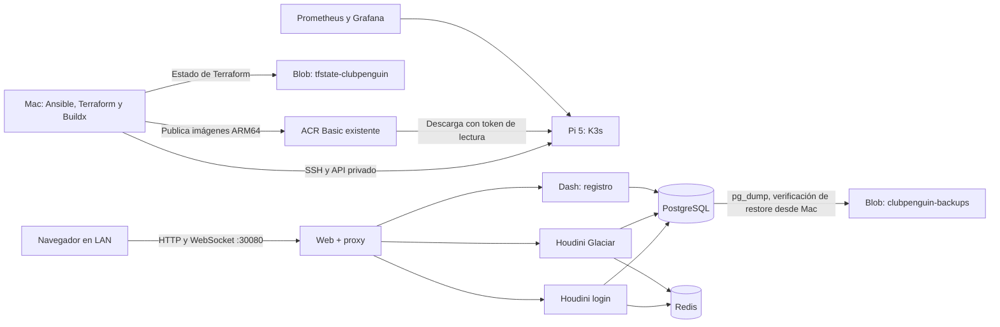

# Club Penguin AS2: Raspberry Pi + Azure

Laboratorio DevOps para practicar Ansible, Terraform, Kubernetes, Azure Pipelines,
Prometheus y Grafana. El juego y el monitoreo corren en un Raspberry Pi 5 de 8 GB.
Azure conserva imágenes, estado de Terraform y respaldos. No se crea AKS ni una VM.

## Estado comprobado

Comprobación por SSH y API de Azure, 3 de noviembre de 2026:

- Raspberry: `pi@192.168.0.10`, Debian 13 ARM64.
- K3s existente: `v1.36.5+k3s1`, nodo `penguin-pi` Ready.
- Antes del despliegue: microSD de 57 GB, 46 GB libres y sin PVC de aplicaciones.
- Consumo inicial del nodo: aproximadamente 1.9 GiB, 58 millicores.
- El usuario tiene kubeconfig en `/home/pi/.kube/config`.
- Copia para este laboratorio: `~/.kube/clubpenguin-pi.yaml`, modo 0600.
- ACR Basic existente: `acrdevopslabn3fc0.azurecr.io`.
- Cuenta existente para estado: `sttfstate2188627882`, grupo `rg-tfstate`.
- Se detuvo el AKS anterior `aks-devopslab-lab`, conservando sus recursos;
  Azure confirmó `power=Stopped`, `provisioning=Succeeded`.
  Su costo residual es independiente de este laboratorio.

La propiedad del ACR, cuentas Storage y AKS originales permanece en sus estados
existentes. Este proyecto los referencia por data sources y utiliza contenedores
y nombres dedicados. Nunca usar el kubeconfig predeterminado (actualmente AKS)
para desplegar este laboratorio.

## Preparación

Las herramientas Ansible, Terraform, Azure CLI, kubectl y Docker Buildx se ejecutan
desde el Mac. Docker no es un requisito del Pi: K3s ya incluye containerd.

```bash
cd ansible
ansible-playbook preflight.yml
ansible-playbook configure-operator.yml
```

La segunda ejecución de `configure-operator.yml` se comprobó con `changed=0`.
Instala solamente `~/clubpenguin-lab/status.sh` y documentación en el Pi, sin sudo.
No modifica servicios del sistema ni reinstala K3s.

Para otro Mac que todavía no tenga acceso al clúster:

```bash
python3 scripts/sync-kubeconfig.py
kubectl --kubeconfig ~/.kube/clubpenguin-pi.yaml get nodes
```

En sesiones posteriores, iniciar/reutilizar el túnel privado:

```bash
python3 scripts/tunnel.py start
```

El API de Kubernetes se usa mediante `https://127.0.0.1:16443`, con TLS y un túnel
SSH a `192.168.0.10:6443`. El kubeconfig dedicado no reemplaza el contexto AKS.

## Acceso

- Juego en la LAN: **http://192.168.0.10:30080**.
- Web pública: **https://club.example.com**, por Cloudflare Tunnel. El login
  público sigue pendiente de desplegar el nuevo origen permitido y probarlo.
- Registro: **http://192.168.0.10:30080/register.html**.
- Alternativa desde el Mac: `kubectl --kubeconfig ~/.kube/clubpenguin-pi.yaml -n clubpenguin port-forward svc/web 13080:8080`, y abrir **http://localhost:13080**.
- Grafana en el Mac: **http://localhost:13000**, después del port-forward siguiente.
- Prometheus en el Mac: **http://localhost:19090**, después de su port-forward.

Ejecutar cada port-forward en su propia terminal y mantenerla abierta:

```bash
kubectl --kubeconfig ~/.kube/clubpenguin-pi.yaml -n monitoring-lab \
  port-forward --address 127.0.0.1 svc/grafana-lab 13000:80
```

```bash
kubectl --kubeconfig ~/.kube/clubpenguin-pi.yaml -n monitoring-lab \
  port-forward --address 127.0.0.1 svc/prometheus 19090:80
```

Grafana: usuario `admin`. Consultar la contraseña localmente, sin guardarla en Git:

```bash
kubectl --kubeconfig ~/.kube/clubpenguin-pi.yaml -n monitoring-lab \
  get secret grafana-admin -o jsonpath='{.data.admin-password}' | base64 -D
```

Dashboard: **Raspberry Pi · Club Penguin Lab**, con ocho paneles: CPU, RAM, espacio,
disponibilidad, reinicios, memoria por pod, jugadores y disponibilidad del exportador.
Después de una actualización que recree Grafana, reiniciar su port-forward.

El navegador ejecuta Ruffle 0.7.1. Los sockets de Flash se transportan por WebSocket
al mismo servidor HTTP, que sólo puede redirigir a login y Glaciar. Los datos y los
archivos HTTP se sirven en el Pi. Las pruebas completas iniciales fueron en LAN;
la web ya está publicada por el túnel, con verificación del juego público pendiente.

El cliente aprovecha el máximo espacio de la ventana y conserva las proporciones
originales de 760 × 480. El espacio restante queda azul, sin franjas negras.
Una máscara oculta el marco blanco dibujado dentro del archivo Flash y su suavizado.
La presentación inicial de Ruffle y el aviso «Click to unmute» están desactivados;
el motor sigue ejecutando Flash. El navegador puede requerir un clic para el audio.
Mover el puntero muestra los controles superiores; se ocultan tras unos segundos.
El botón **Pantalla completa** oculta la interfaz del navegador; **Esc** permite salir.

Para operar `club.example.com`, consultar [Acceso público y DNS](docs/acceso-publico.md).
El DNS y el conector están configurados. El conector y su política de red se
crearon manualmente y todavía deben importarse al estado Terraform. El código
local permite el hostname público, pero el runtime vivo sigue en `lab-002`.

## Arquitectura y propiedad



Ansible configura archivos
del operador, Terraform administra recursos de Azure dedicados y recursos Kubernetes,
y Helm instala monitoreo a través de Terraform. No se usa Docker Compose.
El conector y la política agregados manualmente son la excepción pendiente de
adopción por Terraform; escribir sus recursos HCL no los incorpora al estado.

## Imágenes y despliegue

Las revisiones originales están fijadas en `sources.json`. Los archivos completos
AS2 ocupan aproximadamente **1.7 GiB extraídos**, y su historial Git superficial
comprimido aproximadamente **1.44 GiB**. Sólo los archivos necesarios entran a la
imagen web; el directorio `.git` no se copia. No redistribuir los medios en el repo.

```bash
python3 scripts/fetch-sources.py
python3 scripts/build-images.py --tag mi-release --platform linux/arm64
python3 scripts/test-containers.py --tag mi-release
python3 scripts/publish-images.py --tag mi-release
```

`test-containers.py` usa una red Docker aislada, crea cuentas sintéticas, verifica
login y entrada a la misma sala y prueba el proxy WebSocket. Limpia sus contenedores
y volúmenes de prueba. Nunca apunta a la base de datos del Raspberry.

En un checkout nuevo, copiar `infra/cluster/terraform.tfvars.example` a
`infra/cluster/terraform.tfvars` y elegir las etiquetas ya publicadas. El despliegue
actual usa `lab-002` para runtime/database y `lab-006` para web, con las rutas del
cliente corregidas, fondo azul y vista de pantalla completa. Cambiar sólo web no reinicia PostgreSQL ni el mundo.

```bash
terraform -chdir=infra/cluster init -backend-config=backend.hcl.example
terraform -chdir=infra/cluster plan -out=release.tfplan
terraform -chdir=infra/cluster apply release.tfplan
```

Revisar que el plan sólo afecte al laboratorio. Los planes pueden contener secretos;
mantenerlos privados y no subirlos como artefactos públicos. El contenedor remoto de
estado usa Azure Blob y su bloqueo nativo; las credenciales se protegen con RBAC.

## Validaciones y métricas

Validación local de configuración:

```bash
bash scripts/validate.sh
```

Prueba del backend real en el Pi, que crea dos cuentas sintéticas:

```bash
kubectl --kubeconfig ~/.kube/clubpenguin-pi.yaml -n clubpenguin \
  exec -i deploy/dash -- python - < scripts/game-smoke.py
```

Se comprobaron registro, login, selección de Glaciar y entrada al mundo desde el
cliente Ruffle en Chromium, primero localmente y después contra el Raspberry por
port-forward. El navegador automatizado no pudo acceder directamente a la IP LAN;
las peticiones HTTP desde el Mac a `192.168.0.10:30080` sí respondieron 200.
Dos clientes de protocolo compartieron la sala 100 tanto en Docker como en el Pi.
Esto no es una prueba de carga de 20 usuarios.

Mediciones iniciales, antes de jugadores reales:

- Monitoreo: aproximadamente 530 MiB sumando Grafana, Prometheus y exportadores.
- Backend más monitoreo: nodo alrededor de 2.8 GiB y 3% de CPU en una muestra.
- Con la web lista: muestra de aproximadamente 3 GiB de RAM y 39 GB libres.
- Primera descarga web: 1,787,884,155 bytes, unos 8 minutos 28 segundos en este Pi.
  La imagen queda en la caché de containerd para los siguientes arranques.
- Prometheus conserva 48 horas, con retención por tamaño de 3 GB y PVC de 5 GiB.
- Grafana usa un PVC de 1 GiB; PostgreSQL, uno de 4 GiB.
- Son directorios sobre la misma microSD, no discos físicos separados.

El exportador publica `clubpenguin_players{world="Glaciar"}` y
`clubpenguin_redis_up`; no usa nombres de jugadores como etiquetas. Hay reglas
para poco espacio y deployments no disponibles. No se configuraron envíos de
notificaciones externas. La capacidad inicial del mundo es 20, como cupo de prueba.

## Respaldos

Desde el Mac, con el Pi encendido y Azure CLI autenticado:

```bash
python3 scripts/backup.py
```

El script genera un dump de PostgreSQL, restaura en una base temporal `verify_*`,
comprueba que puede leer las cuentas, elimina sólo esa base de verificación y sube
el dump y un manifiesto SHA256 a Azure. Conserva copia privada en `.local/backups/`.
La prueba inicial produjo un dump de unos 356 KB y se verificó su presencia en Blob.
La base se inicializa con el esquema/datos upstream; el conteo incluye esos datos.

No hay una programación diaria: los respaldos se ejecutan manualmente antes de
apagar o en la etapa de despliegue del pipeline. El Pi apagado no puede generar un
respaldo nuevo. El historial de imágenes y respaldos requiere limpieza periódica;
no hay una regla que borre automáticamente el estado de Terraform.

## Pipeline preparado

`azure-pipelines.yml` está escrito y sus comandos se probaron localmente. No se ha
creado ni ejecutado un pipeline remoto ni publicado este repo en GitHub/Azure Repos.
Antes de activarlo, resolver la adopción de los recursos del túnel y pasar
`cloudflared_enabled=true` explícitamente en CD: el `.tfvars` local no viaja a Git.

- CI valida Terraform/Ansible/Helm y construye/prueba imágenes nativas AMD64 en Ubuntu.
- `deploy=false` por defecto: el CI no tiene credenciales del Pi ni de Azure.
- Con `deploy=true`, sólo desde `main`, CD requiere un agente Mac confiable en la LAN.
- El agente requiere SSH al Pi, kubeconfig dedicado, Docker, Terraform, Azure CLI y Ansible.
- Requiere una conexión Azure con federación de identidad, llamada `clubpenguin-azure`
  por defecto, y un environment `clubpenguin-lab` con sus controles de despliegue.
- Dar a esa identidad permisos de publicación en el ACR y de datos en los
  contenedores de estado/respaldos. El pipeline no administra el AKS anterior.
- Configurar revisión de PR, rama protegida y las aprobaciones del environment en
  Azure DevOps. Los valores del YAML no crean esas políticas automáticamente.

Para Azure Repos, la validación de PR se conecta mediante branch policies; la clave
`pr` del YAML sirve para proveedores que la soportan, como GitHub.

## Estado remoto y almacenamiento

Preparar el backend una sola vez, con sesión Azure CLI y permiso de datos Blob:

```bash
az storage container create --account-name sttfstate2188627882 \
  --auth-mode login --name tfstate-clubpenguin --public-access off

terraform -chdir=infra/cloud init -backend-config=backend.hcl.example
terraform -chdir=infra/cloud plan \
  -var=subscription_id=00000000-0000-0000-0000-000000000000 -out=cloud.tfplan
terraform -chdir=infra/cloud apply cloud.tfplan
```

El backend se prepara fuera del estado que él mismo almacenará. No administra el
contenedor `tfstate` original. Los respaldos se protegen con `prevent_destroy`.
No aplicar reglas de expiración a los archivos de estado de Terraform.

El token `clubpenguin-pi-pull` sólo tiene lectura en `clubpenguin/runtime`,
`clubpenguin/database` y `clubpenguin/web`. Expira el **1 de febrero de 2027**:
rotarlo antes y aplicar el nuevo secreto. El usuario administrador del ACR permanece
deshabilitado. Los secretos se conservan en el estado privado de Terraform.

## Apagado y costos

Apagar el Pi detiene el juego y el monitoreo. ACR sigue cobrando mientras exista,
y Blob sigue cobrando los datos conservados. El presupuesto de US$6–12/mes supone
uso pequeño y no incluye los recursos AKS anteriores, electricidad ni Internet.
Reutilizar el ACR evita pagar un segundo registro; no elimina su cargo existente.

Se detiene el AKS anterior con autorización del usuario; se conservan su balanceador,
IP, discos y demás recursos. Esos recursos pueden seguir cobrando, de modo que
US$6–12 es el presupuesto de esta arquitectura, no una garantía de factura total.

Antes de apagar: terminar la sesión de jugadores, ejecutar/verificar el respaldo
de PostgreSQL y apagar ordenadamente con `sudo shutdown -h now`.
Al encender: comprobar nodo Ready, PVC montados, pods disponibles, base de datos y
login de una cuenta de prueba. Un respaldo solo cuenta como validado después de
restaurarlo y comprobar los datos en una base separada.

## Alcance del juego

Se eligió AS2 y un mundo Glaciar. Ruffle ejecuta el cliente en el navegador y el
proxy conecta sus sockets al backend. Se verifican por separado el cliente web y
el comportamiento del servidor. La compatibilidad de todos los minijuegos y una
prueba de carga sostenida siguen pendientes; las cifras previas de jugadores eran
objetivos de pruebas, no capacidad comprobada.

## Propiedad y seguridad

- Ansible comprueba/prepara el sistema; conserva la instalación K3s existente.
- Terraform administra recursos dedicados del laboratorio.
- Secretos, kubeconfigs, planes y estados no se suben a Git.
- No se exponen Redis, PostgreSQL, Prometheus ni la API Kubernetes a Internet.
- La web usa NodePort 30080. No se modifica Traefik ni sus puertos 80/443.
- Un exportador propio obtiene el total de jugadores desde Redis.
- La primera validación ocurrió en LAN; después se migró el DNS a Cloudflare y se
  publicó la web por un túnel saliente, sin requerir reenvío de puertos del router.
- Houdini/Dash incluyen dependencias heredadas; el laboratorio no demuestra que
  estén libres de vulnerabilidades ni que sean adecuados para exposición pública.
