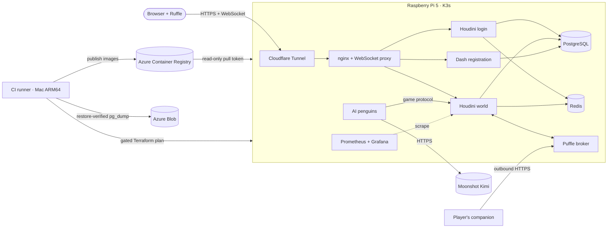

<div align="center">

# AI Penguins | A ClubPenguin Fork


[](https://github.com/AlejoReyna/ClubPenguinFork/actions/workflows/ci.yml)


</div>

The game comes from open-source projects: the [Houdini](https://github.com/solero/houdini) game
server, the [Dash](https://github.com/solero/dash) registration service, and the original
ActionScript 2 client, which runs in the browser through [Ruffle](https://ruffle.rs). This
repository is everything around them: packaging, infrastructure, delivery and operations, plus
new features built from scratch on top of the game protocol.

## Highlights

- **AI penguins.** An NPC service in which every penguin is a real game client with its own
  persona card (23 in the repo). Movement, schedules and travel between rooms are local, seeded
  logic that costs nothing; only speech goes to an LLM (Moonshot Kimi K2.6), and only when a
  human is listening. A per-room director picks at most one speaker per message, a USD spend
  ledger reserves cost before every request and sheds low-priority traffic as it nears the daily
  cap, and the model never gets tools: an action it proposes runs only if it is in a closed,
  locally validated vocabulary. [Design →](docs/bots.md)
- **A conversational puffle.** In your own igloo your puffle chats back and controls *your*
  music (Spotify Web API, or Apple Music on a Mac). A two-step pairing ties a device to an
  authenticated game session; the broker never trusts an ID sent by the browser. Per-player
  rate limits and killable worker processes keep a slow or failing provider from ever blocking
  the game server. [Design →](docs/puffle.md)
- **Playable on a phone.** An installable PWA shell with portrait and landscape layouts, a touch
  dock, and a camera patched into the Flash engine that keeps your own penguin in view.
- **Real delivery on tiny hardware.** K3s on a Raspberry Pi 5, Terraform for both Azure and
  every Kubernetes object, Helm-managed Prometheus and Grafana, NetworkPolicies, and a
  Cloudflare Tunnel, so no router port is open. Image tags are derived from each component's
  content, so a web-only change never restarts PostgreSQL. A deploy applies exactly the saved
  Terraform plan, checked by SHA-256 and by a policy gate (continuous deployment only accepts
  image updates), and takes a restore-verified backup first whenever the plan touches data.
  [Operations →](docs/operations.md)
- **500+ automated tests.** Unit suites run in CI with networking disabled, so an accidental
  call to a paid API is impossible. Integration runs use a disposable Houdini, PostgreSQL and
  Redis on an isolated Docker network.

## Architecture



Azure holds only the image registry, the Terraform state and the backups: no AKS cluster or VM.
Component-level detail, ports and network policies are in [docs/architecture.md](docs/architecture.md).

## Tech stack

| Area | Tools |
|---|---|
| Services I wrote | Python 3.11 `asyncio`; the bots service uses the standard library only |
| Game platform | Houdini and Dash (Python), Ruffle, nginx, a WebSocket-to-TCP proxy |
| Infrastructure | K3s, Terraform (`azurerm`, `kubernetes`, `helm`), Ansible, Docker Buildx (ARM64) |
| Cloud and edge | Azure Container Registry, Azure Blob Storage, Cloudflare Tunnel |
| Delivery | GitHub Actions (OIDC to Azure, self-hosted ARM64 runner), Azure Pipelines |
| Observability | Prometheus, Grafana, kube-state-metrics, node-exporter, custom exporters |
| AI | Moonshot Kimi K2.6 (OpenAI-compatible API), Sign in with ChatGPT on the player's own plan |

## Repository layout

```
containers/
  bots/              AI penguin service: sessions, director, brain, spend ledger, persona cards
  runtime/           Houdini/Dash entrypoint, WebSocket proxy, metrics exporter, panel sidecar
  web/               nginx config, game page, installable PWA shell, puffle page
  database/          PostgreSQL image with the lab's seed overlay
experiments/puffle_sim/  Puffle core: engine, Houdini bridge, providers, music backends
production/puffle/       Puffle broker, lab host mode and the player's companion
infra/cloud/         Terraform: registry pull token and backup container (applied by an operator)
infra/cluster/       Terraform: every Kubernetes resource plus the Helm releases (applied by CD)
ansible/             Read-only Pi preflight and operator files
monitoring/          Prometheus and Grafana values, alert rules, dashboard
scripts/             Release, deploy, backup and test tooling (kebab-case files are CLIs)
tests/               Unit and integration suites for bots, puffle, production and web
```

The puffle core lives under `experiments/` because it began as an offline simulator before it
shipped; the runtime image installs it into Houdini today.

## Running the tests

The same commands CI runs. They need Docker and network access only to fetch the pinned
upstream sources; the test containers themselves run with networking disabled.

```bash
python3 scripts/fetch-sources.py --only houdini,dash,ruffle
python3 scripts/build-images.py --tag dev --components runtime,database,web,bots --web-media stub

bash scripts/run-bot-tests.sh clubpenguin/runtime:dev        # bots service
bash scripts/run-puffle-tests.sh clubpenguin/runtime:dev     # puffle engine, broker, host
python3 scripts/test-containers.py --tag dev --web-tag dev --bots-tag dev --puffle  # integration

bash scripts/install-tools.sh && export PATH="$PWD/.local/tools:$PWD/.local/tools/ansible/bin:$PATH"
bash scripts/validate.sh    # Terraform, Ansible, ruff, script unit tests, pipeline policy, Helm
```

`--web-media stub` replaces the 1.7 GiB of game media with placeholders, so the build stays small.
`install-tools.sh` pins every tool by version (and by checksum for binaries); its Ansible
environment needs Python 3.12–3.14, selectable with `PYTHON=python3.13`.

## Deploying

The target is a single Pi, reached through an SSH tunnel to its private Kubernetes API.
`scripts/release.py` builds and publishes ARM64 images, and `scripts/deploy.py` plans, gates,
applies and verifies them. On GitHub Actions the deploy job runs on a self-hosted Mac, in a
branch-restricted environment, and only when an explicit repository switch is on. The full
flow, configuration reference, backups and rollback are in [docs/operations.md](docs/operations.md).

## Privacy and AI use

- Bots run in a simulated mode by default. In API mode, chat in rooms with AI penguins can be sent
  to Moonshot, a third-party provider. Conversation memory is in RAM only; the optional
  relationship notes are capped at 120 characters per bot and player, and expire after 30 days.
- Puffle provider credentials stay on the player's own computer (or, in the single-operator lab
  mode, are stored AES-256-GCM encrypted on the server).
- Upstream game media is fetched at build time from a pinned revision and is not stored in this
  repository, apart from a few catalog overrides and one custom item.

## Credits

Built on [Houdini](https://github.com/solero/houdini), [Dash](https://github.com/solero/dash) and
the legacy media archive by [Solero](https://github.com/solero), and on [Ruffle](https://ruffle.rs).
Club Penguin is a trademark of Disney. This is an unofficial, non-commercial learning project,
not affiliated with or endorsed by Disney.
