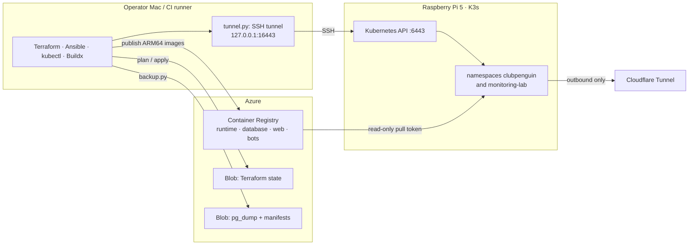
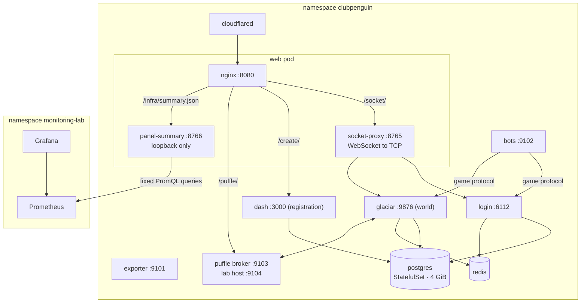

# Architecture

The whole lab runs on one Raspberry Pi 5 (8 GB, ARM64) with single-node K3s. An operator Mac
on Apple silicon builds the ARM64 images, runs Terraform and Ansible, and doubles as the
self-hosted CI runner. Azure stores only images, Terraform state and backups. Cloudflare
publishes the website through an outbound tunnel. The sample addresses in this repository
(`192.168.0.10`, `club.example.com`) are placeholders; real values live in private files
(see [operations](operations.md#configuration)).

| Terraform root | Manages | Applied by |
|---|---|---|
| `infra/cloud` | Backup container; registry scope map and the Pi's read-only pull token | An operator, with their own Azure permissions |
| `infra/cluster` | Namespaces, PostgreSQL, Redis, game services, web, bots, puffle, tunnel connector, NetworkPolicies, `release-info`, Prometheus and Grafana (Helm) | `scripts/deploy.py`, locally or from CD |
| `ansible/` | Read-only Pi preflight and a few operator files | An operator, or `deploy.py preflight` |

Keeping `infra/cloud` out of the pipeline is deliberate: it writes to a registry and a storage
account shared with other projects, so the release identity never holds those permissions.

## Workloads

Most services share one **runtime** image and pick their role from `MODE` (`login`, `world`,
`dash`, `exporter`, `proxy`, `panel`, `puffle`). Updating it rolls those workloads but never
PostgreSQL. The other images are **web** (unprivileged nginx, Ruffle, the game media and the
patched `engine.swf`), **database** (PostgreSQL 16 plus a seed overlay) and **bots** (Python
3.11, standard library only, no credentials baked in).

| Workload | Port | Exposure |
|---|---|---|
| web (nginx) | 8080 | NodePort 30080 on the LAN; Cloudflare reaches it through the cluster Service |
| login | 6112 | NodePort 30612 on the LAN |
| glaciar (world) | 9876 | NodePort 30976 on the LAN |
| dash, exporter, puffle, bots, redis, postgres | 3000, 9101, 9103/9104, 9102, 6379, 5432 | Cluster only |
| Prometheus, Grafana | 80 | Cluster only; reached with `kubectl port-forward` |

The browser never talks TCP: Ruffle opens WebSockets to nginx, and `socket-proxy` bridges them
to exactly two endpoints (login and world) after checking the `Origin` header.

## Network policies

Policies are additive, so every exception is a separate, named object:

| Policy | Selects | Allows |
|---|---|---|
| `game-ingress` | Every game pod except the puffle broker | Traffic from the lab's own pods; Prometheus to the exporter (9101); the LAN CIDR to 6112, 9876 and 8080 |
| `web-from-cloudflared` | web | The tunnel connector to 8080 |
| `web-to-prometheus` | web (egress) | The Prometheus server in `monitoring-lab` on 9090, for the panel sidecar |
| `bots-egress` | bots (egress) | DNS, login and world; public HTTPS (443, private ranges excluded) only when the provider mode is `api` |
| `bots-metrics` | bots | Prometheus scrapes |
| `puffle` | puffle broker | Its own ingress and egress |

Known gap: the web egress rule is designed to sit next to a namespace-wide
`egress-internal-only` policy (same namespace plus DNS) that is not yet declared in Terraform.

## Security posture

- **No inbound internet exposure.** The Pi only dials out to Cloudflare, so no router ports are
  open. The Kubernetes API is reachable only through an SSH tunnel to `127.0.0.1:16443` with a
  dedicated kubeconfig, never the operator's default context.
- **Containers.** The lab's own services (game, web, bots, puffle, tunnel connector) run as
  non-root with privilege escalation disabled, every Linux capability dropped and no
  service-account token mounted. Bots, the puffle broker and the panel sidecar also use a
  read-only root filesystem; bots and the broker add the `RuntimeDefault` seccomp profile.
  PostgreSQL and Redis keep the defaults of their upstream images.
- **Secrets.** Nothing secret is in Git. The tunnel token Secret is created by hand so it never
  reaches the Terraform state. The registry pull token can only read the lab's repositories, and
  the registry admin user stays disabled.
- **CI.** Pull-request jobs carry no credentials. Deploy and backup jobs authenticate to Azure
  through GitHub OIDC (no long-lived cloud secret), run only from `main` in branch-restricted
  environments, and share one concurrency group so they never overlap.
- **Limits.** Houdini and Dash are legacy upstream projects; the lab does not claim they are
  hardened for hostile traffic. One node means one point of failure, and there is no SLA.

## Observability

Prometheus (chart 29.40.3) and Grafana (chart 14.3.1) are Helm releases inside the `infra/cluster`
Terraform root, in the `monitoring-lab` namespace. Prometheus keeps 48 hours of data (capped at
3 GB, on a 5 GiB volume). It scrapes kube-state-metrics, node-exporter and every pod annotated
with `prometheus.io/scrape`: the game exporter (9101), bots (9102) and the puffle broker (9103).

- **Metrics without personal data.** `clubpenguin_players{world="Glaciar"}`,
  `clubpenguin_redis_up` and the bots and puffle series use bounded labels; player names and chat
  text never become labels.
- **Alert rules.** `RaspberryLowDiskSpace`, `LabDeploymentUnavailable`, `BotsSessionsBelowTarget`,
  `BotsDailySpendHigh`, `BotsProviderErrorRateHigh`, `BotsPlannedRoomEmpty`,
  `PuffleBrokerUnavailable` and `PuffleQueueSaturated`. Alertmanager is disabled, so alerts are
  visible in Prometheus but not routed to any notification channel yet.
- **Dashboard.** "Raspberry Pi · Club Penguin Lab": CPU, RAM, disk, availability, restarts,
  per-pod memory, players and exporter health.
- **In-game panel.** The game page has an "Infraestructura" panel. nginx forwards
  `GET /infra/summary.json` to the `panel-summary` sidecar on loopback, which runs a fixed set of
  PromQL queries (2-second timeout, 15-second cache). The browser never learns where Prometheus
  or Grafana live, and a Prometheus outage only greys out the panel.

## Capacity

The world accepts 20 players by default (`world_capacity`), a test quota rather than a measured
limit. At first deploy, before bots and the puffle, the node used about 3 GiB of RAM with the
game, web and monitoring running (monitoring alone was about 530 MiB). The first pull of the
full web image (about 1.8 GB) took roughly eight minutes on the Pi; containerd caches it after that.
