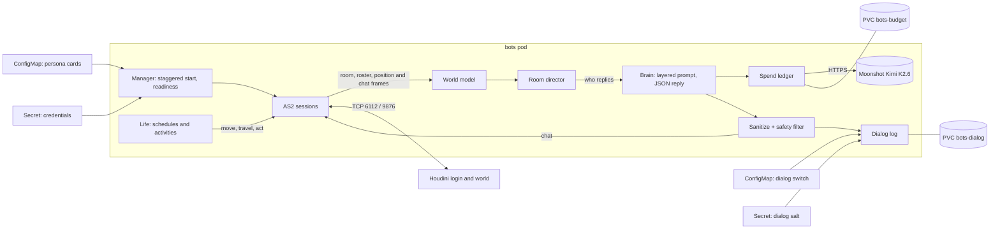

# AI penguins (bots service)

`containers/bots/` is an asyncio service that keeps AI-controlled penguins online in the
Glaciar world. Each penguin is a normal game client: it logs in with its own account, joins
rooms, walks, dances and chats over the same AS2 protocol a browser uses, so Houdini needs no
changes and moderators can mute or kick a bot like any other player. The service is one
process with standard-library code only, run as a single replica with the `Recreate` strategy,
because each account must have exactly one owner.

## Design principles

1. **The body is local; only the voice is a model.** Walking, dancing, schedules and travel
   between rooms are deterministic, seeded code that costs nothing. The LLM only writes lines.
2. **Spend only when a human is listening.** Nothing is sent to the provider for an empty room,
   so keeping every penguin online around the clock is free while the island is empty.
3. **One voice per room.** A human message gets at most one bot reply; penguins never compete.
4. **The model proposes, the code decides.** Replies are JSON (`{"say": ..., "do": ...}`). `do`
   may only be `null`, `dance`, `wave` or `sit`; anything else is ignored. The model has no
   tools, and travel is decided by local rules, never by model output.
5. **Honesty.** Asked seriously whether it is a bot, a penguin admits being an AI, in character.

## Architecture



| Module | Responsibility |
|---|---|
| `as2.py` | AS2 wire client, aligned with the real lab servers |
| `session.py` | Login, room join, reconnect with jittered backoff |
| `manager.py` | Runs every configured bot concurrently; readiness when ≥ 80 % of sessions are in a room |
| `world.py` | Shared in-process model: who is in each room, humans versus bots, positions |
| `director.py` | One dialogue owner per room: replies, greetings, short scenes, travel reservations |
| `brain.py` | Stable prompt layers, data-only human turns, closed pose outputs |
| `provider.py`, `http_client.py` | Moonshot client with bounded retries and cancellable sockets, plus a simulated provider |
| `spend.py` | USD spend ledger (see [Spend control](#spend-control)) |
| `text.py`, `safety.py` | Input sanitation, mention matching, output filtering |
| `life.py`, `travel.py`, `events.py` | Seeded activities, room-to-room travel with occupancy leases, calendar events |
| `memory.py`, `recall.py` | Short-term memory per speaker; optional relationship notes on the PVC |
| `dialog_log.py` | Append-only JSONL dialog log on its own PVC. Callers use `emit` only (see [Dialog log](#dialog-log)) |
| `cast.py`, `rooms.py`, `actions.py` | Persona cards, measured room catalog, closed action vocabulary |
| `metrics.py` | Prometheus endpoint with no third-party dependency |
| `music.py` | Forwards a player's own music request to the puffle host |

## Room director

The director observes every room a bot is in and decides who speaks and when:

- A human who names a penguin in the room gets an answer from that penguin.
- A human who names nobody gets zero or one reply. The candidate is chosen by continuity (who
  talked to that player in the last two minutes), then topic affinity, then proximity, then
  whoever is least busy. The reply probability is 60 % for a greeting, 50 % for a question and
  25 % otherwise.
- When a human enters, one penguin may greet them after a short delay, at most once per player
  and room every ten minutes, mostly with the card's own greetings rather than the model.
- Bot-to-bot scenes only happen while a human is present and are written in one request for
  every line.
- "Where is Rayo?" is answered from the world model, without the model. Invitations such as
  "Lola, vamos a la pizzería" become a local travel intent that is accepted or declined against
  occupancy rules.
- A player who reaches 40 model replies in a day gets local lines from then on, so one person
  cannot exhaust the budget.

Prompts put the stable parts first (global rules, then the persona card) to benefit from prefix
caching, followed by the situation, the player's recent turns and finally the player's message,
delimited as data rather than instructions.

## Persona cards

One JSON file per penguin lives in `containers/bots/cast/` and reaches the pod through a
ConfigMap; credentials stay in a Secret and are joined to the card by `username`. A card is
validated field by field (unknown keys are rejected, lists and strings are bounded) and holds:

| Field | Purpose |
|---|---|
| `username`, `nickname`, `aliases` | Identity and the names players use to address the penguin |
| `home_room`, `home_pois` | Where the penguin belongs and the points of interest it uses there |
| `archetype`, `voice`, `likes`, `dislikes`, `knows`, `topics`, `chattiness` | Personality for the prompt and the director's topic matching |
| `relationships` | Named ties to other penguins (rival, admires, ...) |
| `schedule`, `wander`, `idle_actions` | Daily time blocks, favourite rooms, idle body actions |
| `greetings`, `fallbacks` | Local lines used without the model, or when it is unavailable |
| `music`, `appearance`, `enabled` | Music forwarding, clothing, and a per-penguin kill switch |
| `role` | Optional `helper` or `guide`. Either one never enters an igloo and never accepts an igloo invitation. Absent on a normal resident. A JSON file with only `username` and `role` stamps that role onto an existing Secret entry (the work accounts) without replacing its post |

## Life and travel

Each penguin spends about three quarters of its time in its home room. Every 20–60 seconds it
picks an activity from its schedule and favourites, with randomness seeded per penguin so tests
are reproducible. Travel goes through the director, which holds atomic occupancy reservations:
a room in the plan never drops below its minimum while a human is inside, two penguins cannot
leave the same room at once, and an absence is a bounded lease after which the penguin returns.
A penguin that talked to a human in the last three minutes stays put.
An igloo is a travel destination with the same reservation, the same minimum
while a human is in the source room, and the same lease home. The body stands
on the basic igloo's fixed post `(380, 320)` and does not walk there. `helper`
and `guide` never take part. A resident may invite someone who is in the room,
or answer a human who invites them, using the card, the schedule and a seeded
roll (`igloo_invite.py`). The model only writes the spoken line, and only when
a human is there and the spend cutoff still allows it.

## Measured zones (zonas medidas)

Houdini relays any coordinates it receives, so a point the server accepts is not proof that it
is walkable. Every walkable rectangle in `data/rooms.json` was therefore measured, never guessed:

1. Export the room SWF's `block_mc` collision mask with FFDec. A filled area is blocked,
   matching `isPositionValid` in `engine.swf`.
2. Derive rectangles in raw AS2 stage coordinates, the ones sent in `j#jr`/`u#sp`.
3. Check them in Ruffle with a penguin at every corner and at the centre.

A room is `measured: true` only after that process, and its `source` field says how it was
measured. An unmeasured room carries no rectangles: a bot assigned there holds one fixed post at
the designer's own `start_x/start_y` from the SWF. The work posts used by the original three
staff penguins live in `scripts/bot_accounts.py` (`MEASURED_WORK_AREAS`).

## Spend control

`spend.py` replaces a simple request counter with a ledger kept in micro-USD on the `bots-budget`
volume:

- Every attempt, retries included, reserves an estimated cost **before** it is sent; the
  provider's reported `usage` then replaces the estimate. A failed request keeps its estimate,
  because the provider may have processed it.
- Daily and monthly caps (defaults: US$1 and US$30) plus a per-minute attempt window.
- Priorities degrade gracefully: bot-to-bot chatter (P2) stops at 80 % of the daily cap, model
  greetings (P1) at 95 %, and direct replies to a human (P0) only when the cap would be exceeded.
  Refused callers fall back to the card's local lines.
- It fails closed: if the ledger cannot be written, nothing is sent. The file must be private
  and not a symlink.

A typical reply is about 1,000 input and 40 output tokens. The cap belongs to this service, not
to the provider account: other applications sharing the same API key still bill.

## Safety and privacy

- Player text is sanitized (control characters, protocol separators, command prefixes) and
  every outgoing line, from the model or local, passes the same filter. It blocks links,
  domains, emails and long digit runs, plus an optional word list exported from the game's chat
  filter. A rejected line is replaced by a fallback; lines are capped at 54 characters.
- Penguins never ask for age, location, social accounts or passwords, and do not repeat personal
  data a player shares.
- Chat addressed to the penguins goes to Moonshot only in `api` mode; the image defaults to
  `simulated`. Short-term memory (eight turns, ten minutes) lives in RAM. Optional relationship
  notes are unchanged: stored per bot and numeric player id, capped at 120 characters, and
  expire after 30 days. Lines and decisions are recorded by the optional dialog log below,
  which is separate from those notes.
- An optional dialog log records what the bots say (replies, greetings, bot-to-bot scene lines)
  and their decisions (invite, accept, decline, travel), plus the human message that triggered
  a reply. The contract is [Dialog log](#dialog-log).
- Human text is stored only after the same sanitization in `text.py`. The player is
  pseudonymized as a salted hash; the salt comes from a Secret. The numeric id and the name
  are never stored in clear. The raw player id never leaves the process.
- Retention is 30 days. Events are deleted automatically.
- Kill switch: a ConfigMap key, re-read at runtime (hot reload, no redeploy), off by default.
  When it is off, nothing is written.
- The log is never exposed through Cloudflare Tunnel or any public Ingress. It is read only
  via SSH or `kubectl port-forward` from the owner's Mac. It is never sent to external
  services or used for training.
- Metrics about the log carry no chat text in labels.

## Dialog log

`containers/bots/bots/dialog_log.py`, owned by Bitácora, exposes `emit(...)`. Callers in
`director.py`, `travel.py` and `life.py` (owned by Vida) only call `emit`. Those call sites
are not in this change. `manager.py` only starts and stops the writer task. A change to
`emit`'s signature has to be agreed first. The service has no function that reads the log
back, and `/metrics` is not a read API for it.

`emit` is synchronous and does no I/O. It calls `put_nowait` on a bounded in-memory queue
(2048 events) and never raises. When the switch is off it returns immediately: that is not a
drop, and no day file is created. When the queue is full the event is dropped and
`bots_dialog_log_dropped_total{reason="queue_full"}` increments. A background writer batches
lines (32 events or 30 seconds, whichever comes first) and appends them with `O_APPEND`, one
complete line each. If the store fails, the bots continue, `bots_dialog_log_errors_total`
increments, and the writer backs off. `emit` hashes `player_id` into `player` before
enqueueing and discards the raw id.

Storage is append-only JSONL, one file per UTC day (`YYYY-MM-DD.jsonl`), on a dedicated PVC
`bots-dialog` (1Gi, `local-path`) mounted at `/var/lib/bots-dialog`. It is not the
`bots-budget` volume: if this disk is full or missing, the spend ledger is untouched and the
penguins keep talking. Files are created mode `0600` by UID 10001. A symlink at the day-file
path is refused. A torn last line (the process died mid-write, so the file does not end in a
newline) is given its own newline on the next append; readers skip that incomplete line.

The player hash is HMAC-SHA256, hex-encoded. The key is the environment variable
`BOTS_DIALOG_LOG_SALT`, from the Secret `bots-dialog-salt` key `salt` (created by hand; see
[operations](operations.md#dialog-log)). The value is never logged and is not hot-reloaded:
changing the Secret needs a pod restart, and a new salt makes later hashes not match earlier
ones. If the variable is missing, `player` is null and the raw id is still discarded.

The kill switch is the ConfigMap `bots-dialog-log` key `enabled`, mounted at
`/etc/bots-dialog/enabled` and re-read about every 30 seconds. Only the exact word `true`
turns it on. The default is `false`. Patching the ConfigMap does not roll the pod. The
kubelet can take around a minute to refresh the file, and the process notices on its next
read. Events already queued are discarded without being written once a reload sees the switch
off; that discard is not a drop.

Retention runs in the writer (a ReadWriteOnce volume cannot be mounted by a CronJob while the
pod has it). It runs at startup and about every six hours. It deletes only files whose name
is `YYYY-MM-DD.jsonl` and whose date is more than 30 days before today UTC. The file dated
exactly 30 days ago is kept. Any other name, and any symlink, is left in place. While the
switch is off the directory is not created.

There is no PostgreSQL table and no HTTP route. The log is not added to the Azure backup; it
stays on the Pi. Read it from the operator Mac with `kubectl exec` or `kubectl cp`, then
`scripts/bitacora.py` (standard library only). NetworkPolicies are unchanged: nothing new
listens, Cloudflare Tunnel still reaches only the web pod, and `bots-metrics` / `bots-egress`
are as they were.

Metrics (bounded labels only: event `kind`, or `queue_full` / `io` / `invalid` / `symlink`):

| Series | Meaning |
|---|---|
| `bots_dialog_log_events_total{kind}` | Lines actually written |
| `bots_dialog_log_dropped_total{reason="queue_full"}` | Queue was full. The switch being off is not in this series |
| `bots_dialog_log_errors_total{reason}` | `io`, `invalid`, or `symlink` |
| `bots_dialog_log_queue_depth` | Accepted events not yet written |
| `bots_dialog_log_bytes_total` | Payload bytes written |
| `bots_dialog_log_retention_deleted_total` | Day files removed |
| `bots_dialog_log_enabled` | 1 when the switch is on |
| `bots_dialog_log_salt_configured` | 1 when `BOTS_DIALOG_LOG_SALT` is set. The value is not a label |

`BotsDialogLogWriteErrors` fires when the switch has been on for 15 minutes and `io` or
`symlink` errors are still increasing.

Cost, measured on this implementation. A typical reply line is 345 bytes; a line that fills
both 54-character text fields is 420 bytes. The queue at 2048 maximum lines is about 1.2 MiB
(traced allocation; the JSON itself is about 850 KiB). Building one event is about 80 µs, and
a 32-line flush is about 150 µs, so 40,000 events in a day are a few seconds of CPU. The
writer does not `fsync`. At a steady 2,500 events/day each event falls in its own 30-second
window, about 2,500 `write()` calls and about 0.9 MB appended. At a steady 40,000 events/day
the 30-second timer wins over the 32-line batch (about 14 lines each), about 2,880 `write()`
calls and about 14 MB appended. If every small append rewrites a 4 KiB flash page, that is on
the order of 10 MB/day at 2,500 events and 10–25 MB/day at 40,000. A power cut can lose the
open batch (at most 30 seconds) plus whatever the kernel has not written back.

`emit` is keyword-only:

```text
emit(*, room_id, speaker, kind, target_kind, source,
     target=None, player_id=None, text=None, human_text=None,
     priority=None, scene_id=None, invite_id=None, reason=None,
     dest_room_id=None, ts=None)
```

`scripts/bitacora.py` reads a directory of day files (a torn last line is ignored):

```bash
python3 scripts/bitacora.py --dir ./bots-dialog filter --room 110 --penguin rayo \
    --since 2026-11-01 --until 2026-11-11
python3 scripts/bitacora.py --dir ./bots-dialog conversations
python3 scripts/bitacora.py --dir ./bots-dialog matrix
python3 scripts/bitacora.py --dir ./bots-dialog invites
python3 scripts/bitacora.py --dir ./bots-dialog sources
python3 scripts/bitacora.py --dir ./bots-dialog phrases --top 20
python3 scripts/bitacora.py --dir ./bots-dialog export --format csv --output dialog.csv
python3 scripts/bitacora.py --dir ./bots-dialog export --format jsonl --output dialog.jsonl
```

`conversations` groups a scene by `scene_id`, an invitation by `invite_id`, and other lines
for the same player hash in the same room, splitting a chat when the gap exceeds 10 minutes.
`matrix` counts directed pairs; a player column is `player:` plus the salted hash, not a name.
`invites` joins made / accepted / declined / travel on `invite_id` and counts every `reason`,
including `restart`, `p2_cutoff` and `seeded_roll`. `phrases` counts bot `text` only, not
`human_text`. `sources` is the model / local / fallback ratio for spoken lines and for every
event.

| Field | Contents |
|---|---|
| `v` | `1` |
| `ts` | UTC epoch milliseconds |
| `room_id` | int |
| `speaker` | Username of the penguin speaking or deciding |
| `kind` | `reply`, `greeting`, `scene`, `invite`, `accept`, `decline` or `travel` |
| `target_kind` | `player`, `bot` or `room` |
| `target` | Bot username, or null when the target is a player or the room (the player goes in `player`) |
| `player` | Salted hash, or null. The `emit` input is `player_id`, which is never stored |
| `text` | The final line after the safety filter (≤ 54 characters), exactly what was sent. Null for `invite`, `accept`, `decline` and `travel` when there is no spoken line |
| `human_text` | The triggering human message after `text.py` sanitization, only on `reply`; otherwise null |
| `source` | `model`, `local` or `fallback` |
| `priority` | `P0`, `P1`, `P2` or null |
| `scene_id` | str or null. Groups the lines of one bot-to-bot dialogue scene only |
| `invite_id` | str or null. Links the invite, the accept or decline, the travel and the return trip of the same invitation |
| `reason` | Short closed code, or null. Only on `accept`, `decline` and `travel` |
| `dest_room_id` | int or null. Destination for `invite`, `accept`, `decline` and `travel`. For an igloo it is the Houdini external id `penguin_id + 2000` (the id carried in `j#jr`). A return home uses the catalog room id |

Initial `reason` vocabulary. Extending it requires updating this document.

- `relation_friend`
- `busy_with_human`
- `recent_decline`
- `low_energy`
- `off_schedule`
- `lease_expired`
- `room_min_guard`
- `restart`: forced return because the service restarted.
- `p2_cutoff`: return or decline caused by the P2 spend cutoff.
- `seeded_roll`: no hard rule decided; the outcome came from the seeded random roll, so analysis can tell rule-based from chance decisions.

When events are emitted:

- `reply`, `greeting` and `scene`: right after the safety filter, at the point where the line
  is handed to the session (what was actually said, not what the model proposed).
- `invite`: whenever an invitation is born, wherever it comes from. The director may turn a
  player message into a travel intent, or `life.py` may decide on its own that a bot invites
  another, for example to its igloo.
- `accept` and `decline`: when occupancy and behavior rules decide, with `reason`.
- `travel`: when a penguin actually leaves for another room, including forced returns
  (`lease_expired`, `restart`, `p2_cutoff`), with `reason`.

Bitácora implements `dialog_log.py`, the store, retention, metrics and tests. Vida adds the
`emit` calls in `director.py`, `travel.py` and `life.py`.

## Operations

- `/healthz` reports the process, `/readyz` requires most sessions to be inside a room, and
  `/metrics` (port 9102) exposes sessions, reconnects, replies by priority and source, provider
  errors and latency, and spend against the cap, all with bounded labels and no chat text.
- Alert rules in `monitoring/bots-rules.yaml` cover sessions below target, daily spend above
  80 %, a high provider error rate, a planned room left empty, and dialog-log write errors
  while the log is enabled.
- Scaling the deployment to zero keeps both volumes. `bots-budget` has `prevent_destroy`.
  `bots-dialog` does not: turning `bots_enabled` off plans deletion of the log. Setting
  `enabled: false` on a card silences a single penguin and does not touch the log.
- The pod mounts no service-account token, runs as UID 10001 with a read-only root filesystem,
  and its egress policy allows only DNS, the game servers and (in `api` mode) public HTTPS.

## Testing

`scripts/test-bots.py` runs the suite (329 tests) against an in-memory fake world: director
arbitration, occupancy minimums, travel leases, the spend ledger, the output filter, prompt
shapes and seeded life, including a virtual 48-hour run that checks room coverage, plus the
dialog log (contract, privacy, switch, retention, metrics) and `scripts/bitacora.py`. CI runs
it inside the runtime image with `--network none`, so no test can reach a paid provider.
`scripts/test-containers.py` adds an end-to-end run against a disposable Houdini with a fake
provider and no outbound network. With `--bots-tag` it also runs the dialog-log image check:
one line when the switch file is `true`, and no day file when it is `false`. That check calls
`emit` itself, because `director.py`, `travel.py` and `life.py` do not yet.

The ARM64 igloo acceptance bench is `scripts/test-containers.py --igloos --bots-tag TAG`
(with runtime/database tags). It uses disposable Houdini and simulated providers. See
[bots-igloos-banco.md](bots-igloos-banco.md) for the reproducible command, scope,
limitations and manual provisioning/deploy/rollback steps for Alexis.
