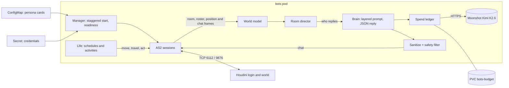

# AI penguins (bots service)

`containers/bots/` is an asyncio service that keeps AI-controlled penguins online in the
Glaciar world. Each penguin is a normal game client: it logs in with its own account, joins
rooms, walks, dances and chats over the same AS2 protocol a browser uses, so Houdini needs no
changes and moderators can mute or kick a bot like any other player. The service is one
process with standard-library code only, run as a single replica with the `Recreate` strategy,
because each account must have exactly one owner.

## Design principles

1. **The body is local; only the voice is a model.** Walking, dancing, schedules and travel
   between rooms are deterministic, seeded code that costs nothing. The LLM only writes lines.
2. **Spend only when a human is listening.** Nothing is sent to the provider for an empty room,
   so keeping every penguin online around the clock is free while the island is empty.
3. **One voice per room.** A human message gets at most one bot reply; penguins never compete.
4. **The model proposes, the code decides.** Replies are JSON (`{"say": ..., "do": ...}`). `do`
   may only be `null`, `dance`, `wave` or `sit`; anything else is ignored. The model has no
   tools, and travel is decided by local rules, never by model output.
5. **Honesty.** Asked seriously whether it is a bot, a penguin admits being an AI, in character.

## Architecture

| Module | Responsibility |
|---|---|
| `as2.py` | AS2 wire client, aligned with the real lab servers |
| `session.py` | Login, room join, reconnect with jittered backoff |
| `manager.py` | Runs every configured bot concurrently; readiness when ≥ 80 % of sessions are in a room |
| `world.py` | Shared in-process model: who is in each room, humans versus bots, positions |
| `director.py` | One dialogue owner per room: replies, greetings, short scenes, travel reservations |
| `brain.py` | Stable prompt layers, data-only human turns, closed pose outputs |
| `provider.py`, `http_client.py` | Moonshot client with bounded retries and cancellable sockets, plus a simulated provider |
| `spend.py` | USD spend ledger (see [Spend control](#spend-control)) |
| `text.py`, `safety.py` | Input sanitation, mention matching, output filtering |
| `life.py`, `travel.py`, `events.py` | Seeded activities, room-to-room travel with occupancy leases, calendar events |
| `memory.py`, `recall.py` | Short-term memory per speaker; optional relationship notes on the PVC |
| `cast.py`, `rooms.py`, `actions.py` | Persona cards, measured room catalog, closed action vocabulary |
| `metrics.py` | Prometheus endpoint with no third-party dependency |
| `music.py` | Forwards a player's own music request to the puffle host |

## Room director

The director observes every room a bot is in and decides who speaks and when:

- A human who names a penguin in the room gets an answer from that penguin.
- A human who names nobody gets zero or one reply. The candidate is chosen by continuity (who
  talked to that player in the last two minutes), then topic affinity, then proximity, then
  whoever is least busy. The reply probability is 60 % for a greeting, 50 % for a question and
  25 % otherwise.
- When a human enters, one penguin may greet them after a short delay, at most once per player
  and room every ten minutes, mostly with the card's own greetings rather than the model.
- Bot-to-bot scenes only happen while a human is present and are written in one request for
  every line.
- "Where is Rayo?" is answered from the world model, without the model. Invitations such as
  "Lola, vamos a la pizzería" become a local travel intent that is accepted or declined against
  occupancy rules.
- A player who reaches 40 model replies in a day gets local lines from then on, so one person
  cannot exhaust the budget.

Prompts put the stable parts first (global rules, then the persona card) to benefit from prefix
caching, followed by the situation, the player's recent turns and finally the player's message,
delimited as data rather than instructions.

## Persona cards

One JSON file per penguin lives in `containers/bots/cast/` and reaches the pod through a
ConfigMap; credentials stay in a Secret and are joined to the card by `username`. A card is
validated field by field (unknown keys are rejected, lists and strings are bounded) and holds:

| Field | Purpose |
|---|---|
| `username`, `nickname`, `aliases` | Identity and the names players use to address the penguin |
| `home_room`, `home_pois` | Where the penguin belongs and the points of interest it uses there |
| `archetype`, `voice`, `likes`, `dislikes`, `knows`, `topics`, `chattiness` | Personality for the prompt and the director's topic matching |
| `relationships` | Named ties to other penguins (rival, admires, ...) |
| `schedule`, `wander`, `idle_actions` | Daily time blocks, favourite rooms, idle body actions |
| `greetings`, `fallbacks` | Local lines used without the model, or when it is unavailable |
| `music`, `appearance`, `enabled` | Music forwarding, clothing, and a per-penguin kill switch |

## Life and travel

Each penguin spends about three quarters of its time in its home room. Every 20–60 seconds it
picks an activity from its schedule and favourites, with randomness seeded per penguin so tests
are reproducible. Travel goes through the director, which holds atomic occupancy reservations:
a room in the plan never drops below its minimum while a human is inside, two penguins cannot
leave the same room at once, and an absence is a bounded lease after which the penguin returns.
A penguin that talked to a human in the last three minutes stays put.

## Measured zones (zonas medidas)

Houdini relays any coordinates it receives, so a point the server accepts is not proof that it
is walkable. Every walkable rectangle in `data/rooms.json` was therefore measured, never guessed:

1. Export the room SWF's `block_mc` collision mask with FFDec. A filled area is blocked,
   matching `isPositionValid` in `engine.swf`.
2. Derive rectangles in raw AS2 stage coordinates, the ones sent in `j#jr`/`u#sp`.
3. Check them in Ruffle with a penguin at every corner and at the centre.

A room is `measured: true` only after that process, and its `source` field says how it was
measured. An unmeasured room carries no rectangles: a bot assigned there holds one fixed post at
the designer's own `start_x/start_y` from the SWF. The work posts used by the original three
staff penguins live in `scripts/bot_accounts.py` (`MEASURED_WORK_AREAS`).

## Spend control

`spend.py` replaces a simple request counter with a ledger kept in micro-USD on the `bots-budget`
volume:

- Every attempt, retries included, reserves an estimated cost **before** it is sent; the
  provider's reported `usage` then replaces the estimate. A failed request keeps its estimate,
  because the provider may have processed it.
- Daily and monthly caps (defaults: US$1 and US$30) plus a per-minute attempt window.
- Priorities degrade gracefully: bot-to-bot chatter (P2) stops at 80 % of the daily cap, model
  greetings (P1) at 95 %, and direct replies to a human (P0) only when the cap would be exceeded.
  Refused callers fall back to the card's local lines.
- It fails closed: if the ledger cannot be written, nothing is sent. The file must be private
  and not a symlink.

A typical reply is about 1,000 input and 40 output tokens. The cap belongs to this service, not
to the provider account: other applications sharing the same API key still bill.

## Safety and privacy

- Player text is sanitized (control characters, protocol separators, command prefixes) and
  every outgoing line, from the model or local, passes the same filter. It blocks links,
  domains, emails and long digit runs, plus an optional word list exported from the game's chat
  filter. A rejected line is replaced by a fallback; lines are capped at 54 characters.
- Penguins never ask for age, location, social accounts or passwords, and do not repeat personal
  data a player shares.
- Chat addressed to the penguins goes to Moonshot only in `api` mode; the image defaults to
  `simulated`. Short-term memory (eight turns, ten minutes) lives in RAM. Optional relationship
  notes are stored per bot and numeric player id, capped at 120 characters, and expire after
  30 days.

## Operations

- `/healthz` reports the process, `/readyz` requires most sessions to be inside a room, and
  `/metrics` (port 9102) exposes sessions, reconnects, replies by priority and source, provider
  errors and latency, and spend against the cap, all with bounded labels and no chat text.
- Alert rules in `monitoring/bots-rules.yaml` cover sessions below target, daily spend above
  80 %, a high provider error rate, and a planned room left empty.
- Scaling the deployment to zero keeps the volume and its ledger. Setting `enabled: false` on a
  card silences a single penguin.
- The pod mounts no service-account token, runs as UID 10001 with a read-only root filesystem,
  and its egress policy allows only DNS, the game servers and (in `api` mode) public HTTPS.

## Testing

`scripts/test-bots.py` runs the suite (269 tests) against an in-memory fake world: director
arbitration, occupancy minimums, travel leases, the spend ledger, the output filter, prompt
shapes and seeded life, including a virtual 48-hour run that checks room coverage. CI runs it
inside the runtime image with `--network none`, so no test can reach a paid provider.
`scripts/test-containers.py` adds an end-to-end run against a disposable Houdini with a fake
provider and no outbound network.
