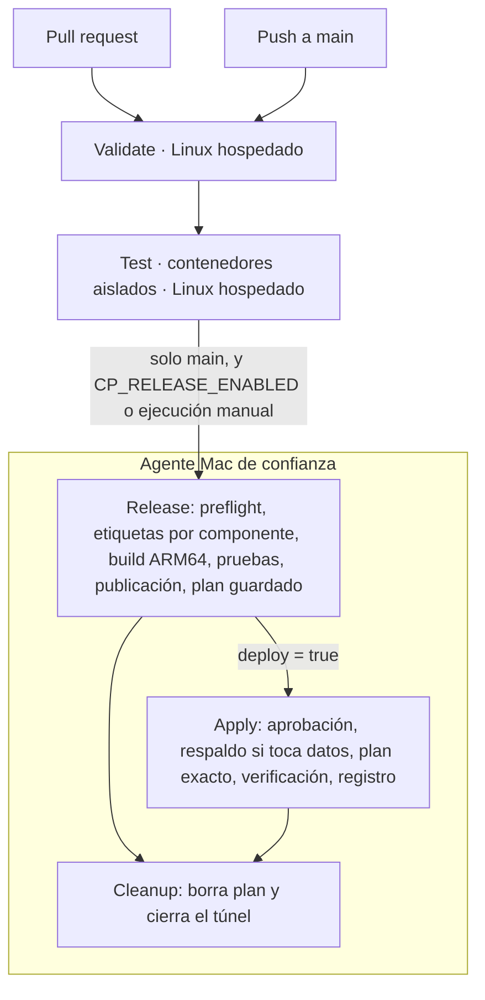

# CI/CD con Azure DevOps Pipelines

Este directorio documenta cómo `azure-pipelines.yml` valida, construye, publica y
despliega el laboratorio. **El YAML no configura por sí solo** la conexión con GitHub,
la service connection de Azure, el agente, el environment ni las políticas de rama:
cada pieza se crea fuera del repositorio (guía en [azure-devops-y-github.md](azure-devops-y-github.md)).
Hasta que existan, el pipeline no se ha ejecutado de forma remota.

| Documento | Contenido |
|---|---|
| [puffle-produccion.md](puffle-produccion.md) | Implementación, emparejamiento por jugador, acompañante, pruebas y recuperación |
| [plan-produccion-integral.md](plan-produccion-integral.md) | Análisis del árbol completo y plan de producción para CI/CD, NPC, puffle y música; incorpora la aceptación musical de Alexis |
| [configuracion.md](configuracion.md) | Valores privados, variables, parámetros del pipeline |
| [azure-devops-y-github.md](azure-devops-y-github.md) | Conexión GitHub, identidad federada, permisos, pool, environment, ramas |
| [agente-mac.md](agente-mac.md) | Instalación y endurecimiento del agente Mac; túnel SSH al API privado |
| [primera-ejecucion.md](primera-ejecucion.md) | Primer CI y primer CD, paso a paso |
| [adopcion-cloudflared.md](adopcion-cloudflared.md) | Importar al estado el conector creado a mano |
| [respaldos-y-rollback.md](respaldos-y-rollback.md) | Cuándo respaldar, rollback de aplicación, recuperación de datos |
| [observabilidad.md](observabilidad.md) | Señales, dónde mirar, evidencia y alertas reales |

## Flujo

- **PR**: `Validate` y `Test` en agentes de Microsoft. Sin credenciales de Azure, sin
  acceso al Pi, sin variables privadas. Las etapas con credenciales ni siquiera se
  ejecutan en PR (condición explícita, comprobada por `scripts/lint_pipeline.py`).
- **main**: lo mismo, más `Release` en el Mac **solo si** la variable de pipeline
  `CP_RELEASE_ENABLED=true` o si alguien lanza la ejecución con `release`/`deploy`.
  `Release` publica imágenes nuevas en el ACR y deja un **plan guardado**. No aplica nada.
- **Despliegue**: `deploy = true` en una ejecución manual sobre `main`. El job de
  `Apply` espera la aprobación del environment y aplica **exactamente** el plan
  revisado (se comprueba su SHA-256), con respaldo previo si el plan toca datos.
- **Por defecto no se despliega nada**: `deploy` vale `false`, y `release` también.

## Qué administra cada raíz de Terraform

| Raíz | Administra | Quién la aplica |
|---|---|---|
| `infra/cluster` | Namespaces, PostgreSQL, Redis, runtime, web, conector, políticas, `release-info`, Prometheus, Grafana | **El pipeline** (plan guardado + aplicación aprobada) |
| `infra/cloud` | Contenedor de respaldos, scope map y token de **solo lectura** del Pi en el ACR | **Un operador**, a mano, con sus propios permisos |

`infra/cloud` necesita escribir en recursos compartidos (el ACR y la cuenta de
Storage también los usa el laboratorio anterior). La identidad de la release no debe
tener esos permisos, así que el pipeline solo valida `infra/cloud` (`fmt` y `validate`).
Si cambia, el operador ejecuta `plan`/`apply` desde su sesión.

## Releases e imágenes

- Cada componente (`runtime`, `database`, `web`; `bots` cuando tenga `Dockerfile`
  versionado) tiene su **propia etiqueta**, derivada del contenido de sus entradas:
  `rt-…`, `db-…`, `web-…` con 12 hex. Cambiar solo el frontend cambia solo `web-…`.
  PostgreSQL no se reinicia (demostrado con planes reales, ver abajo y las pruebas
  unitarias de `scripts/tests/test_release.py`).
- Si el registro ya tiene esa etiqueta, **se reutiliza**: no se reconstruye ni se
  vuelve a subir (la imagen web pesa 3,7 GB con medios).
- Nunca se usa `latest`. El manifiesto de release (`release-manifest.json`) liga
  commit → etiquetas → digests → plataforma `linux/arm64`; se publica como artefacto
  de la ejecución y, tras un despliegue verificado, se guarda en Blob
  (`releases/<UTC>-<commit12>.json`).
- Antes de publicar se exige `linux/arm64`, y se rechazan imágenes de prueba (con
  medios de relleno).
- El Pi descarga con el token de **solo lectura** (`clubpenguin-pi-pull`, creado por
  `infra/cloud`). Las credenciales de publicación son de la identidad federada, viven
  en una configuración de Docker temporal y se borran al terminar.
- El servicio `socket-proxy` va dentro de la imagen `runtime`: cambiarlo reinicia
  login, Glaciar, Dash, el exportador y el pod web, **pero no PostgreSQL**.

## Alcance demostrado con planes reales (solo lectura)

`terraform plan -refresh=false -lock=false` contra el estado remoto real, el 3 de
noviembre de 2026. El Pi estaba apagado, así que no incluye drift vivo:

| Escenario | Cambios en recursos de aplicación | Respaldo previo |
|---|---|---|
| Etiquetas actuales con `image_tag`/`web_image_tag` (compatibilidad) | Ninguna imagen cambia | No |
| Solo frontend (`web-…`) | Solo `web` (más `release-info`) | **No** |
| Solo runtime (`rt-…`) | login, glaciar, dash, exporter y pod web; **PostgreSQL no** | Sí |
| Solo base de datos (`db-…`) | Solo el StatefulSet de PostgreSQL | Sí |

El plan real también mostró dos hallazgos que el pipeline ahora impide: aplicar el
código anonimizado habría reescrito `game-ingress` con la LAN de ejemplo
(`CP_LAN_CIDR` es ahora obligatorio), y el conector con su política siguen fuera
del estado (el plan los intentaría crear; se bloquea hasta
[importarlos](adopcion-cloudflared.md)).

## Matriz de etapas

| Etapa | Agente | Credenciales | Entradas | Resultado | Prueba realizada | Pendiente |
|---|---|---|---|---|---|---|
| Validate | Ubuntu hospedado | Ninguna | Checkout, herramientas fijadas con checksum | `fmt`/`validate`, Ansible, Python, JSON, shell, Helm, pruebas unitarias, lint del pipeline, decisión de cambios | `scripts/validate.sh` completo en el Mac | Primera ejecución remota |
| Test | Ubuntu hospedado | Ninguna (red `--internal`, sin Moonshot) | Fuentes fijadas (sin medios), caché BuildKit | Build nativo, registro, login, sala compartida, proxy WS, nginx → proxy → login | `test-containers.py` con imágenes ARM64 locales: pasa; red sin salida demostrada | Ejecución en Ubuntu amd64 |
| Release | Mac (pinneado) | Federada (`AzureCLI@2`), solo ACR + Blob | Commit, `sources.json`, `deploy.env` | Etiquetas por componente, build ARM64, publicación, manifiesto, plan guardado y evaluado | Etiquetas, política y planes reales sin refresh; sonda WS; respaldo contra un PostgreSQL en contenedor | Preflight, túnel, publicación y plan con refresh contra el Pi (apagado) |
| Apply | Mac (mismo agente) | Federada; sin token en el entorno | Plan guardado + SHA-256 + manifiesto | Respaldo condicional, plan exacto aplicado, verificación, registro en Blob | Lógica de política, hash y respaldo previo; fallos | Todo contra el Pi real; configurar environment y aprobaciones |
| Cleanup | Mac | Ninguna | Directorio de la ejecución | Plan borrado, túnel cerrado si lo abrió esta ejecución | Pruebas unitarias de limpieza y propiedad del túnel | Ejecución real |

Pendientes externos (no automatizables desde el repo) en
[primera-ejecucion.md](primera-ejecucion.md#pendientes-externos).
