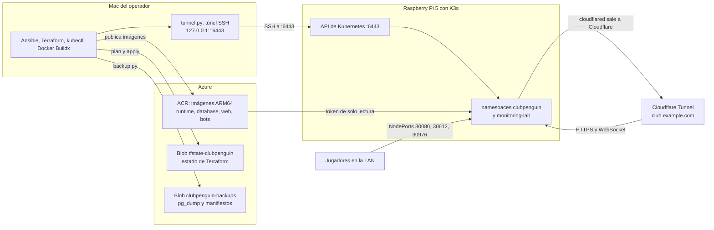
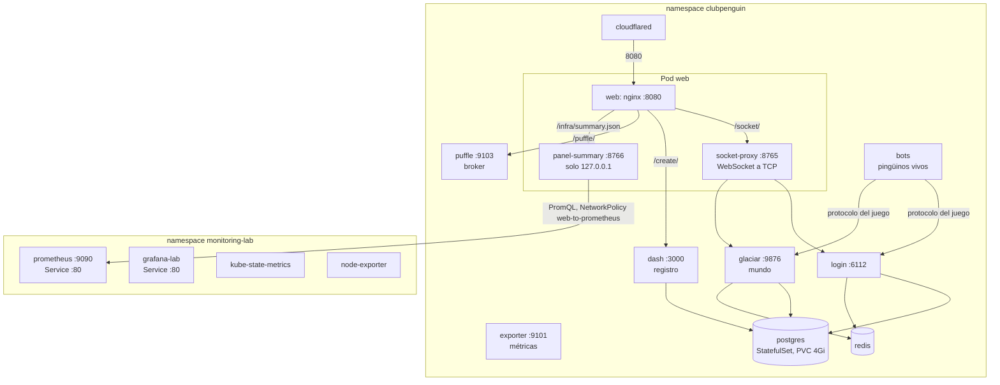
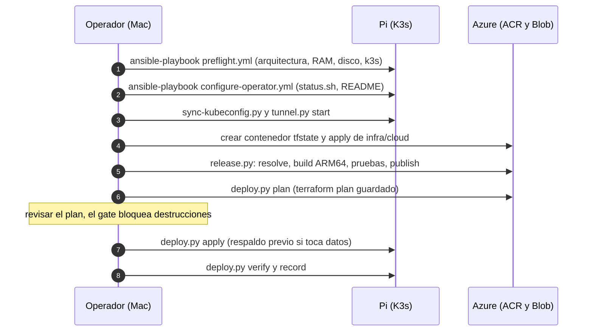
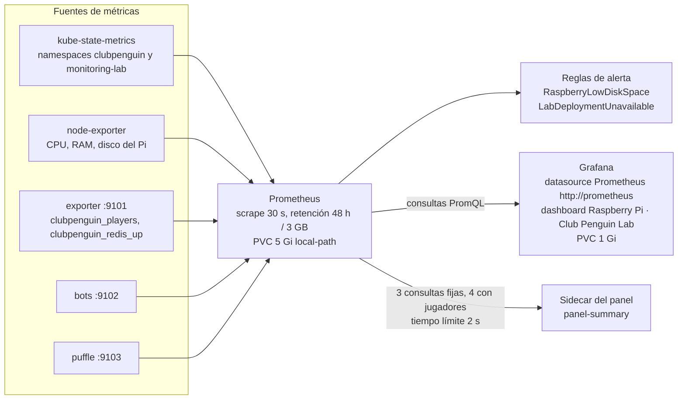
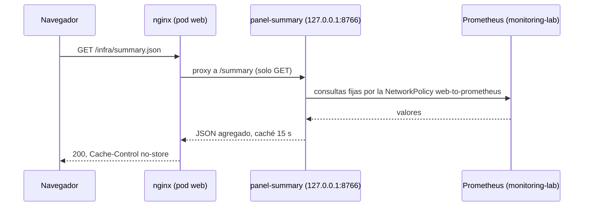
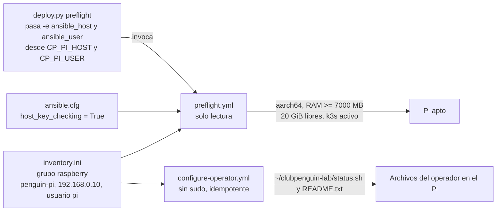

# Infraestructura: Kubernetes, instalación, monitoreo y Ansible

Mapa de la infraestructura de ClubPenguin Lab tal como está definida en el repositorio
(`infra/cluster/*.tf`, `infra/cloud/main.tf`, `monitoring/`, `ansible/`, `scripts/`). Las direcciones
(`192.168.0.10`, `club.example.com`) son ejemplos anonimizados; los valores reales viven en archivos
privados (`deploy.env`, `terraform.tfvars`, `backend.hcl`).

Índice: [1. Vista general](#1-vista-general) · [2. Kubernetes](#2-kubernetes-k3s-en-el-pi) ·
[3. Instalación](#3-instalación-paso-a-paso) · [4. Configuración](#4-configuración) ·
[5. Prometheus y Grafana](#5-cómo-se-conectan-prometheus-y-grafana) · [6. Ansible](#6-ansible)

## 1. Vista general



Quién administra qué:

| Raíz | Contiene | Se aplica |
|---|---|---|
| `infra/cloud` | contenedor de respaldos, scope map y token de solo lectura del Pi en el ACR | operador, a mano |
| `infra/cluster` | namespaces, PostgreSQL, Redis, runtime, web, Puffle, bots, conector, políticas de red, `release-info`, Prometheus y Grafana (Helm) | `scripts/deploy.py` (plan guardado + apply) |
| `ansible/` | verificación del Pi y archivos del operador | operador, a mano o desde `deploy.py preflight` |

## 2. Kubernetes (K3s en el Pi)

### 2.1 Cargas de trabajo



Las imágenes `login`, `glaciar`, `dash`, `exporter`, `puffle` y el `socket-proxy` y `panel-summary` del
pod web son **la misma imagen `runtime`** (`MODE=login|world|dash|exporter|proxy|panel`); cambiarla
reinicia todas esas cargas, pero no PostgreSQL. `web` usa la imagen `web` (nginx + Ruffle + medios).

### 2.2 Puertos y exposición

| Carga | Puerto | Exposición |
|---|---|---|
| web (nginx) | 8080 | NodePort **30080**; Cloudflare Tunnel lo alcanza por el Service interno |
| login | 6112 | NodePort **30612** |
| glaciar | 9876 | NodePort **30976** |
| dash, exporter, puffle, redis, postgres | 3000, 9101, 9103, 6379, 5432 | solo ClusterIP |
| prometheus, grafana-lab | 80 | solo ClusterIP; acceso por `kubectl port-forward` |

### 2.3 Políticas de red

Las políticas se suman (unión de reglas). El resultado es un laboratorio cerrado: cada pod solo
habla con su propio namespace, y cada excepción tiene una política con nombre.

| Política | Aplica a | Qué permite |
|---|---|---|
| `egress-internal-only` | todos menos bots, cloudflared y puffle | salida solo al mismo namespace y a DNS |
| `game-ingress` | todos menos puffle | entrada desde el propio laboratorio; desde `monitoring-lab` al puerto 9101; desde el CIDR de la LAN a 6112, 9876 y 8080 |
| `web-from-cloudflared` | web | entrada de cloudflared al 8080 |
| `web-to-prometheus` | web | salida al servidor Prometheus de `monitoring-lab`, puerto 9090, y nada más |
| `bots-egress`, `bots-metrics` | bots | salida a DNS, a login (6112) y glaciar (9876) y, solo con `bots_provider_mode = "api"`, a HTTPS público (443, sin redes privadas); entrada de métricas desde Prometheus |
| `puffle` | puffle | entrada y salida propias del broker |

## 3. Instalación paso a paso



1. **Requisitos en el Mac:** Ansible, Terraform (>= 1.11), Azure CLI con sesión, kubectl, Docker Buildx,
   Python 3. En el Pi: K3s ya instalado (Ansible **no** lo instala), ARM64, 8 GB de RAM, >= 20 GiB libres.
2. **Ansible** (sección 6):
   ```bash
   cd ansible
   ansible-playbook preflight.yml
   ansible-playbook configure-operator.yml
   ```
3. **Acceso a Kubernetes:**
   ```bash
   python3 scripts/sync-kubeconfig.py        # kubeconfig dedicado ~/.kube/clubpenguin-pi.yaml
   python3 scripts/tunnel.py start           # túnel SSH a 127.0.0.1:16443
   python3 scripts/tunnel.py verify          # comprueba que es el Pi, ARM64 y Ready
   ```
4. **Estado remoto y registro (una vez):** crear el contenedor `tfstate-clubpenguin` y aplicar `infra/cloud`
   (contenedor de respaldos, token del Pi en el ACR). Detalle en el README, «Estado remoto y almacenamiento».
5. **Configuración privada:** `deploy.env`, `backend.hcl` y `terraform.tfvars` a partir de los `.example`
   (sección 4).
6. **Release (imágenes):**
   ```bash
   python3 scripts/release.py resolve --pin database=lab-002 --out release.json
   python3 scripts/release.py build --release release.json
   python3 scripts/release.py publish --release release.json --out release.json
   python3 scripts/release.py manifest --release release.json --out manifest.json
   ```
7. **Plan, apply y verificación:**
   ```bash
   python3 scripts/deploy.py plan   --manifest manifest.json
   python3 scripts/deploy.py apply  --expect-sha256 <sha del plan revisado>
   python3 scripts/deploy.py verify --manifest manifest.json
   python3 scripts/deploy.py record --manifest manifest.json
   python3 scripts/deploy.py cleanup
   ```
8. **Primer uso del panel y monitoreo:** secciones 5 y el README («Acceso»).

El pipeline automático solo admite cambios de imagen; los cambios de HCL (como un contenedor nuevo en
el pod web) se planifican y aplican con este procedimiento manual.

## 4. Configuración

| Dónde | Archivo | Qué fija |
|---|---|---|
| Mac, privado `0600` | `~/.config/clubpenguin-lab/deploy.env` | `CP_PI_HOST`, `CP_PI_USER`, `CP_LAN_CIDR`, `CP_ACR_NAME`, `CP_STATE_*`, `CP_PUBLIC_HOSTNAME`, `CP_NODE_NAME`, `CP_PUFFLE_*`, `CP_RELEASE_PINS`, `CP_PROXY_EXTRA_HOSTS` |
| repo, ignorado | `infra/cluster/terraform.tfvars` | habilitación de game, web, cloudflared, bots; etiquetas por defecto |
| repo, ignorado | `infra/*/backend.hcl` | cuenta, contenedor y clave del estado remoto |
| repo | `monitoring/*.yaml` | valores de los charts de Prometheus y Grafana, reglas de alerta |
| Terraform | `panel_prometheus_url`, `panel_grafana_url`, `panel_show_players` | cableado del panel «Infraestructura» (sección 5.3) |

`deploy.env` tiene prioridad sobre valores de ejemplo y las variables de entorno tienen prioridad sobre
el archivo. Los scripts rechazan un `deploy.env` legible por otros usuarios.

## 5. Cómo se conectan Prometheus y Grafana

Ambos se instalan con Helm desde Terraform (`infra/cluster/main.tf`): `prometheus` (chart 29.40.3) y
`grafana` (chart 14.3.1), en el namespace `monitoring-lab`, con valores de `monitoring/`.

### 5.1 Flujo de métricas



- **Descubrimiento:** Prometheus raspa kube-state-metrics y node-exporter (incluidos en el chart) y los pods con
  la anotación `prometheus.io/scrape: "true"` y su `prometheus.io/port` (exporter 9101, bots 9102, puffle 9103).
- **Entrada permitida:** `game-ingress` deja entrar a `monitoring-lab` solo al puerto 9101 de los pods del juego; el
  resto de excepciones (bots, puffle) están en sus propias políticas.
- **Grafana → Prometheus:** datasource aprovisionado `http://prometheus` (Service en el mismo namespace, uid
  `prometheus-lab`, no editable). La contraseña de admin es un Secret (`grafana-admin`, generado por Terraform).
- **Alertmanager está desactivado:** las alertas se ven en Prometheus (`/alerts`), pero nada las envía.

### 5.2 Acceso humano (privado)

Grafana y Prometheus son solo ClusterIP. Se abren por `port-forward` desde el Mac:

```bash
kubectl --kubeconfig ~/.kube/clubpenguin-pi.yaml -n monitoring-lab port-forward --address 127.0.0.1 svc/grafana-lab 13000:80
kubectl --kubeconfig ~/.kube/clubpenguin-pi.yaml -n monitoring-lab port-forward --address 127.0.0.1 svc/prometheus 19090:80
kubectl --kubeconfig ~/.kube/clubpenguin-pi.yaml -n monitoring-lab get secret grafana-admin -o jsonpath='{.data.admin-password}' | base64 -D
```

### 5.3 Panel «Infraestructura» en la página del juego



El navegador nunca recibe la dirección de Prometheus ni de Grafana. Si Prometheus no responde, el panel
muestra «Sin conexión» y el juego no se entera. Grafana aparece como «Acceso privado» mientras
`panel_grafana_url` esté vacía.

## 6. Ansible

Ansible solo **verifica el Pi y prepara archivos del operador**; no instala K3s ni aplicaciones (de eso
se encargan Terraform y Helm).



| Playbook | Qué hace | Cambia el Pi |
|---|---|---|
| `preflight.yml` | exige Linux `aarch64`, >= 7000 MB de RAM, >= 20 GiB libres en `/` y `k3s` activo | no |
| `configure-operator.yml` | crea `~/clubpenguin-lab` (0700), instala `status.sh` (lectura de nodos, pods, PVC, `kubectl top`, disco) y un README | solo esos archivos |

Con otra IP o usuario, sin editar el inventario:
`ansible-playbook preflight.yml -e ansible_host=<ip> -e ansible_user=<usuario>`
(`deploy.py` hace esto con `CP_PI_HOST`/`CP_PI_USER`; `CP_SSH_CONFIG` permite un `ssh_config` alterno).
