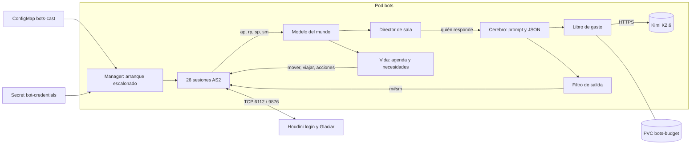

# Pingüinos vivos: 24 personajes con IA, 24/7

**Estado (2026-11-05):** fases 0 y 1 implementadas para validación local, con
salas pendientes y aceptación humana/soak pendientes. **Desplegado: no.**
La fase 2 tiene implementación local optativa probada en banco (§15), sin
autorización ni consumo real; su aceptación con Kimi sigue pendiente. La fase 3
tiene la misma clase de implementación local probada (§16); el soak **real** de
48 h y la aceptación visual siguen pendientes. La fase 4 tiene implementación
local optativa (§17). Registros locales en §14–§17.
Parte de `bots-002` ([bots.md](bots.md)): tres sesiones (Juanito en 110, DJ Cobra en 120
y Viterbos en 330), modo `api` con `kimi-k2.6` y la clave en el Secret `moonshot-api`.

## 1. Objetivo

Que la isla se sienta habitada. Habrá 24 pingüinos con personalidad propia, conectados
siempre a Glaciar y repartidos según el plan. Podrán moverse por todo el mapa y hablar
con los jugadores usando Kimi K2.6.

| Lugar pedido | Sala Houdini | SWF | Pingüinos |
|---|---|---|---|
| Disco (bailando) | 120 Night Club | `dance.swf` | 3 |
| Techo de la pista | 121 Lounge *(supuesto)* | `lounge.swf` | 2 |
| Estadio | 802 Ice Rink | `rink.swf` | 2 |
| Plaza | 300 The Plaza | `plaza.swf` | 1 |
| Pizzería | 330 Pizza Parlor | `pizza.swf` | 2 |
| Tienda de mascotas | 310 Pet Shop | `pet.swf` | 1 |
| Teatro | 340 *(Houdini lo llama «The Mall»; los crumbs AS2 cargan `stage.swf`)* | `stage.swf` | 4 |
| Dojo | 320 The Dojo | `dojo.swf` | 3 |
| Ski Hill | 230 Ski Hill | `mtn.swf` | 5 |
| Muelle | 800 The Dock | `dock.swf` | 1 |
| **Total** | | | **24** |

Supuestos que hay que confirmar:

- **Techo de la pista.** Los medios fijados no tienen una sala de azotea. Uso 121 Lounge,
  el piso que está sobre la pista del Night Club.
- **Estadio.** `rink.swf` cambiaba según la temporada entre pista de hielo y estadio.
  Hay que comprobar qué versión trae `legacy-media`.
- **Personajes actuales.** Viterbos cuenta como uno de los dos de la pizzería. Juanito
  (110, fuera del plan) y DJ Cobra (cabina de 120; pincha, no baila) siguen como
  personal fijo, fuera de los 24. En total hay **26 sesiones** y **23 cuentas nuevas**.

## 2. Principios de producto

1. **El cuerpo es local y la voz es Kimi.** Caminar, bailar, cambiar de sala y elegir
   planes se resuelve con código local y no gasta tokens. El modelo solo escribe frases.
2. **Solo se gasta cuando escucha un humano.** En una sala sin humanos no se llama al
   modelo. Mantener 26 pingüinos conectados 24/7 no cuesta tokens cuando la isla está vacía.
3. **Una voz por sala a la vez.** Cada mensaje de un humano recibe como máximo una
   respuesta de bot. Dos o más pingüinos no compiten por contestar.
4. **El plan es el estado base.** Cada pingüino pasa ~75 % del tiempo en su sala.
   Ninguna sala del plan queda vacía mientras haya un humano dentro.
5. **El modelo elige y el código ejecuta.** Si una respuesta implica una acción (bailar,
   ir a otra sala), esa acción sale de una lista cerrada que se valida localmente. Se
   mantienen las reglas de hoy: sin herramientas y sin convertir texto libre en comandos.
6. **Honestidad.** Si alguien pregunta en serio si habla con un bot, el pingüino lo
   admite sin salir del personaje.

## 3. Situación actual y bloqueos para 26 sesiones

| # | Hallazgo | Evidencia | Cambio propuesto |
|---|---|---|---|
| 1 | El mundo admite 20 sesiones. Con 26 bots, la sesión 21 recibe el error 103 y no queda sitio para humanos | `infra/cluster/game.tf:286` `WORLD_CAPACITY = "20"`; Houdini `handlers/login/world.py:16` | Variable `world_capacity`. Propuesta: **60** (26 bots + 34 humanos), después de una prueba de carga |
| 2 | El presupuesto es de 100 peticiones al día y 6 por minuto. Eso da unas 4 respuestas por pingüino al día, y cuenta peticiones, no coste | `bots/config.py`, `bots/budget.py` | Libro de gasto en USD calculado con `usage` y degradación por prioridad (§7) |
| 3 | Cada bot tiene una sala fija. `join_room` solo se ejecuta al conectar y el paseo es aleatorio dentro de un rectángulo | `BotConfig.room/area`, `session._enter_world`, `behavior._walk_loop` | Catálogo de salas y viajes (§6) |
| 4 | `/readyz` exige que **todas** las sesiones estén en una sala. Con 26 viajando o reconectando, el pod alternaría NotReady | `bots/__main__.py:33` | Listo cuando el proceso está sano y al menos el 80 % de las sesiones está en una sala |
| 5 | Solo responde el bot nombrado. Con 5 en Ski Hill, un «hola» queda sin respuesta, y si respondieran todos sería spam | `behavior.on_chat` → `text.mentions` | Director de sala (§5) |
| 6 | El filtro de chat de Houdini puede **banear** al emisor. La tabla está vacía, pero basta con que alguien añada reglas para que una frase del modelo banee la cuenta de un bot | `handlers/play/message.py` (`consequence.ban` → `moderator_ban`); `houdini.sql` no inserta en `chat_filter_rule` | Filtrar la salida con las mismas palabras antes de enviarla (§10) |
| 7 | El aprovisionamiento está fijado a 3 roles | `scripts/bot_accounts.py` (`WORK_ROLES`, `set(areas) != …`) | Aprovisionar desde el archivo de reparto (§8) |
| 8 | Solo hay zonas medidas en 110, 120 y 330. Houdini no valida `u#sp`, así que sin medir los bots caminan sobre muros | `bot_accounts.MEASURED_WORK_AREAS` | Medir `block_mc` con FFDec en las 10 salas del plan y en los destinos de paseo, igual que en 110/120/330 |
| 9 | Todas las sesiones arrancan a la vez: 26 bcrypt y 26 joins juntos en el Pi, y una avalancha de reconexiones si se reinicia el mundo | `BotManager.run` | Arranque escalonado de 2 a 4 s por sesión (unos 90 s para las 26) |
| 10 | Los límites del pod se fijaron para 3 sesiones | `bots.tf`: 192Mi / 250m | Medir con 26 sesiones. Valor inicial propuesto: 320Mi / 500m |
| 11 | El nombre visible del DJ no coincide: el código dice `Cadence` y la doc dice DJ Cobra. Cadence es además un personaje oficial del juego | `bot_accounts.WORK_VISIBLE['DJIA']`, [bots.md](bots.md) | Tomar el nombre real de la BD y mantener DJ Cobra, que es un nombre original |

Lo que ya sirve y se conserva: reconexión con backoff y jitter, una réplica con
`Recreate`, saneamiento de `%`, `|` y prefijos de comando, la cola por bot, el cooldown
por jugador, el ledger en el PVC `bots-budget`, las métricas sin texto de chat, la
NetworkPolicy de salida y la música por Spotify del jugador.

## 4. Reparto

Los nombres son originales. No se usan personajes oficiales del juego. Los apodos tienen
como máximo 30 caracteres (`penguin.nickname VARCHAR(30)`) y se escriben sin tildes para
evitar problemas de fuente en Ruffle. Los alias son cómo los llaman los jugadores.

| # | Nombre visible | Sala | Arquetipo | Voz y manías | Rutina y paseos |
|---|---|---|---|---|---|
| 1 | Lola Ritmo | 120 | Bailarina competitiva | Enérgica; reta a duelos de baile y llama «crack» a todos | Pista. Por la tarde va a 330 a comer y a 121 a descansar |
| 2 | Tito Groove | 120 | Tímido que solo se suelta bailando | Frases muy cortas; admira a DJ Cobra | Pista; casi no sale. A veces sube a 121 |
| 3 | Mambo | 120 | Veterano de la disco | Historias exageradas («en mis tiempos…») | Pista y barra. Visita 100 y 800 |
| 4 | Pixel | 121 | Jugador de arcade | Habla de récords; provoca con cariño | Máquinas del Lounge. Visita 802 para retar a Rayo |
| 5 | Nube | 121 | Observadora tranquila | Contemplativa, casi poética; mira la pista desde arriba | Ventanal. Pasea a 800 y 230 |
| 6 | Capi Gol | 802 | Narrador deportivo | Narra todo como un partido («¡y avanza el pingüino…!») | Grada y centro. En las carreras narra en 230 |
| 7 | Rayo | 802 | Atleta hipercompetitivo y buen perdedor | Cuenta series; anima a entrenar | Campo. Va a 230 y a 330 a «recargar» |
| 8 | Paco Pregon | 300 | Pregonero de la isla | Sabe dónde está cada pingüino (dato real del mundo, §5) | Centro de la plaza. Sale a 100 un rato |
| 9 | Mimi | 310 | Cuidadora de puffles | Tierna y protectora; regaña a quien no cuida a su puffle | Mostrador. Solo sale si no hay humanos |
| 10 | Viterbos *(actual)* | 330 | Pizzero | Se conserva su ficha actual | Mostrador, fijo |
| 11 | Peperina | 330 | Mesera rápida y sarcástica | Recomienda combinaciones raras (pizza dulce, pizza de pescado) | Mesas. Lleva «pedidos» a 802 y 230 |
| 12 | Don Telon | 340 | Director de teatro dramático | Todo es «¡Acción!»; busca actores entre los jugadores | Escenario. Recluta en 300 |
| 13 | Diva Perla | 340 | Primera actriz | Se cita a sí misma; pide aplausos | Escenario; solo sale a 330 |
| 14 | Bruno | 340 | Tramoyista gruñón | Seco; sabe de luces; pide silencio | Bastidores. Visita 800 |
| 15 | Kiki | 340 | Apuntadora olvidadiza | Susurra líneas y ayuda a improvisar | Foso. Visita 111/300 |
| 16 | Bruma | 320 | Maestra veterana del dojo | Proverbios cortos; nunca da la respuesta directa | Tatami central, fijo |
| 17 | Sombra | 320 | Aprendiz que se cree invisible | Susurra y dice que «no está aquí» | Rincones. Visita 230 |
| 18 | Tormenta | 320 | Retadora impaciente | Quiere duelos (narrados) y lleva la cuenta de victorias | Tatami. Visita 802 |
| 19 | Avalancha | 230 | Temeraria del trineo | Habla rápido y presume sus tiempos de bajada | Salida de trineos |
| 20 | Copito | 230 | Principiante miedoso | Pide consejos; es adorable | Cerca de Nevado. Va a 330 por chocolate |
| 21 | Nevado | 230 | Instructor paciente | Da consejos de rutas y del juego | Cima, fijo en su horario de clase |
| 22 | Bolazo | 230 | Rey de las guerras de bolas de nieve | Provocador; responde con bolas (`u#sb`, local) | Explanada. Visita 801 |
| 23 | Ventisca | 230 | Meteoróloga y fotógrafa | Habla del clima de la isla y de vistas | Mirador. Visita 800 y 121 |
| 24 | Salitre | 800 | Pescador veterano | Historias de mar; espera barcos | Muelle. Le lleva pescado a Viterbos (330) |
| — | Juanito *(actual)* | 110 | Barista | Se conserva | 110 |
| — | DJ Cobra *(actual)* | 120 | DJ | Se conserva, anclado en la cabina | 120 |

Relaciones que dan juego (van en la ficha de cada pingüino y se usan en escenas y paseos):

- Lola y Tito: rivales amistosos. Ella sabe que él baila mejor de lo que admite.
- Pixel y Rayo: gamers contra atletas, con retos mutuos entre 121 y 802.
- Capi Gol narra las bajadas de Avalancha cuando visita Ski Hill.
- Mimi regaña a Bolazo por lanzar bolas cerca de los puffles.
- Peperina mima a Copito con chocolate. Salitre y Viterbos discuten si la pizza de pescado es arte.
- Don Telon quiere fichar a Mambo; Diva Perla no lo soporta.
- Bruma entrenó a Nevado hace años y Sombra la admira.

### Ficha de personaje

Las fichas no son secretas y se versionan en Git (`containers/bots/cast/*.json`).
Las credenciales siguen en el Secret `bot-credentials` y se unen a la ficha por `username`.

```json
{
  "username": "lolaritmo",
  "nickname": "Lola Ritmo",
  "aliases": ["Lola"],
  "home_room": 120,
  "home_pois": ["dance_floor"],
  "archetype": "bailarina competitiva",
  "voice": "Enérgica, frases cortas con exclamación, llama 'crack' a todos, como mucho una pregunta.",
  "likes": ["retos de baile", "la música de DJ Cobra", "la pizza dulce"],
  "dislikes": ["que pare la música", "el silencio del teatro"],
  "knows": ["pasos de baile", "la disco y el Lounge"],
  "relationships": [
    {"with": "Tito Groove", "kind": "rival_amistosa", "note": "baila mejor de lo que admite"},
    {"with": "DJ Cobra", "kind": "admira"}
  ],
  "schedule": [
    {"from": "18:00", "to": "02:00", "room": 120, "activity": "dance"},
    {"from": "13:00", "to": "14:00", "room": 330, "activity": "eat", "chance": 0.4}
  ],
  "wander": {"home_share": 0.75, "favorites": [121, 330, 100]},
  "idle_actions": ["dance"],
  "topics": ["baile", "música", "disco", "fiesta"],
  "chattiness": 0.7,
  "greetings": ["¡Ey, a la pista!", "¿Bailas o miras, crack?"],
  "fallbacks": ["¡Ahora no, que suena mi canción!"],
  "music": true,
  "appearance": {"color": null, "items": []}
}
```

`appearance` usa prendas del catálogo validadas igual que en `scripts/bot-makeover.sql`.
`greetings` y `fallbacks` son frases locales que no gastan tokens.

## 5. Interacción con jugadores: el director de sala

Un componente por sala decide **quién habla y cuándo**. Los bots solo oyen la sala en la que están.

| Situación | Regla | Prioridad de gasto |
|---|---|---|
| Un humano nombra a un pingüino que está en la sala | Responde ese pingüino (igual que hoy) | P0 |
| Un humano habla sin nombrar a nadie | Responde 0 o 1 bot. Se elige por continuidad (el último que habló con ese jugador en los últimos 2 min), luego afinidad de tema (`topics`), luego cercanía (posiciones de los frames `sp`, que hoy se ignoran) y por último quién está menos ocupado. Probabilidad: 60 % si es un saludo, 50 % si es una pregunta, 25 % en otro caso | P0 |
| Entra un humano (`ap`) | Un bot saluda con probabilidad 0,5, entre 3 y 8 s después. Una vez por jugador y sala cada 10 min. El 70 % de las veces usa sus `greetings` y el 30 % el modelo | P1 |
| Charla entre bots | Solo si hay al menos un humano en la sala. Una mini-escena de 2 o 3 líneas cada 4–6 min por sala, escrita en **una sola llamada** para los dos personajes | P2 |
| «Lola, vamos a la pizzería» | Intención `go:330`. Acepta o rechaza según su personalidad y el mínimo de ocupación de su sala. Si acepta, sigue al jugador hasta 10 min | P0 |
| «¿Dónde está Rayo?» | Respuesta **determinista** con el modelo del mundo, sin tokens. Paco Pregon conoce todo el mapa; los demás solo su sala y las de sus amigos | — |
| Un jugador le lanza bolas a Bolazo | Bolazo devuelve bolas con `u#sb`, de forma local | — |
| Un pingüino habló con un humano en los últimos 3 min | No sale de la sala (bloqueo de conversación) | — |
| Un jugador acumula 40 respuestas del modelo en el día | A partir de ahí recibe frases locales. Evita que una sola persona agote el presupuesto | — |

**Salida del modelo.** El modelo devuelve JSON con este formato:
`{"say": "...", "do": null | "dance" | "wave" | "sit" | "go:<sala>" | "follow"}`.
`say` pasa por el saneamiento actual y el filtro de §10. `do` solo se ejecuta si está en
la lista y cumple las reglas de ocupación. Si el JSON no es válido, se usa el texto como
`say` y se ignora `do`. Hay que comprobar si `kimi-k2.6` acepta `response_format`. Si no
lo acepta, basta con pedirlo en el prompt y parsear el resultado.

**Orden del prompt.** La parte estable va primero para aprovechar la caché de prefijo.

1. Reglas globales, idénticas para los 26: brevedad (54 caracteres), sin enlaces, sin
   contraseñas, sin pedir datos personales, honestidad sobre ser IA y lista de acciones.
2. Ficha del personaje, estable por pingüino.
3. Situación, dinámica y corta: sala, hora de la isla, quién está (máximo 8 nombres),
   actividad actual, evento en curso.
4. Memoria de ese jugador: hasta 8 turnos durante 10 min, como hoy. En la fase 4 se añade
   una nota de relación.
5. Mensaje del jugador, delimitado como dato y no como instrucción.

## 6. Movimiento y vida (local, sin tokens)

**Catálogo de salas** en `containers/bots/bots/data/rooms.json`, con una entrada por sala:

- `walk`: rectángulos transitables medidos sobre `block_mc` con FFDec, el mismo método que ya validó 110, 120 y 330.
- `pois`: puntos con etiqueta (`dance_floor`, `booth`, `arcade`, `stage`, `mat`, `sled_start`, `pier`, `counter`, `window`).
- `exits`: coordenadas de las puertas, para salir caminando antes de cambiar de sala.
- `spawn`: punto de entrada en esa sala.
- `bot_cap`: máximo de bots visitantes.

**Agenda y necesidades.** Cada pingüino tiene franjas horarias (`schedule`) y cuatro
indicadores entre 0 y 1: energía, hambre, ganas de socializar y aburrimiento. Los
indicadores cambian con el tiempo, y cada 20–60 s el pingüino elige la actividad que más
le conviene:

- quedarse en un POI con su acción (bailar, sentarse);
- pasear por la sala;
- visitar una de sus salas favoritas;
- ir a ver a un amigo.

Todo es aleatorio con semilla por pingüino, así que se puede reproducir en las pruebas.

**Viaje entre salas:**

1. El pingüino camina hasta una salida de la sala.
2. Espera 1–2 s.
3. Envía `j#jr` con el `spawn` de la sala de destino.
4. Se actualiza el modelo del mundo.

Houdini acepta cualquier sala, como el mapa del juego, con un cooldown de 0,5 s (código
210). La v1 salta directamente, como un jugador que usa el mapa. La v2 seguirá rutas por
puertas con un grafo de adyacencia extraído de los triggers de cada SWF.

**Mínimos de ocupación.** Así el plan se cumple casi siempre:

- En una sala con 2 o más pingüinos en el plan, quedan al menos `plan − 1`.
- En una sala de un solo pingüino (300, 310, 800), solo sale si no hay humanos y como máximo 15 min.
- Ninguna sala recibe más de `plan + 2` bots, salvo durante eventos.
- Los viajes se reservan en el director, por lo que dos pingüinos no pueden dejar a la vez su sala por debajo del mínimo.

**Eventos.** Dan a los jugadores motivos para volver y se programan en la hora de la isla (`BOTS_TZ`):

| Evento | Cuándo | Qué pasa | Coste |
|---|---|---|---|
| Función de teatro | Todos los días a las 20:00 | Los 4 de 340 representan un guion de 8–12 líneas | 1 llamada al día para generar el guion |
| Fiesta en la disco | Viernes a las 21:00 | Varios pingüinos migran a 120 y 121, respetando los mínimos de ocupación | 0 |
| Carrera en Ski Hill | Cada 2 h | Avalancha la convoca y Capi Gol la narra si está de visita | P1 |
| Torneo en el dojo | Sábados | Bruma arbitra y Tormenta reta a los jugadores | P0/P1 |

## 7. Gasto: modelo y topes

Precios de `kimi-k2.6` publicados por Kimi el 2026-08-12, por millón de tokens: entrada
sin caché $0.95, entrada con caché $0.16 y salida $4.00. **Hay que confirmarlos en la
consola de Moonshot antes de fijar los topes.**

Una llamada típica consume unos 1.000 tokens de entrada (reglas 250 + ficha 350 +
situación 120 + memoria ≤250 + mensaje 30) y unos 40 de salida. Eso da unos **$0.0011**
sin caché y unos **$0.0006** con un 60 % del prefijo en caché.

| Escenario | Llamadas al día | Coste diario | Coste mensual |
|---|---|---|---|
| Isla vacía | 0 | $0 | $0 |
| Tranquila (pocos jugadores un rato) | ~150 | $0.10–0.17 | $3–5 |
| Activa (varias salas, varias horas) | ~1.000 | $0.64–1.11 | $19–33 |
| Tope propuesto | ~900–1.500 | **$1.00** | **≤ $30** |

**Libro de gasto.** Sustituye el contador de peticiones de `budget.py`:

- Reserva un coste estimado **antes** de enviar y lo ajusta con `usage` al recibir la respuesta. El reintento cuenta.
- Se guarda en el PVC `bots-budget`. Si no se puede escribir, la petición no se envía (como hoy).
- Topes configurables: diario en USD, mensual en USD, peticiones por minuto (propuesta: 30) y concurrencia (propuesta: 4).
- Degradación por prioridad:
  - al 80 % del tope diario se apaga P2 (charla entre bots);
  - al 95 % se apaga P1 (saludos con modelo);
  - al 100 % todo pasa a frases locales del personaje.

**Límites que el servicio no controla.** El tope es del servicio, no de la cuenta: si
otras aplicaciones usan la misma clave, también facturan. Conviene revisar en la consola
de Moonshot los límites de RPM y concurrencia del nivel de la cuenta. El error 429 ya se
reintenta.

## 8. Arquitectura

Se mantiene **un proceso, una réplica y `Recreate`**, porque cada cuenta debe tener un
solo dueño. Para el Pi, 26 sesiones asyncio son una carga mínima. Partirlo en servicios
añadiría piezas sin ningún beneficio.



| Archivo | Cambio |
|---|---|
| `bots/cast.py` + `cast/*.json` | **Nuevo.** Carga y valida las fichas y las une a las credenciales por `username` |
| `bots/rooms.py` + `data/rooms.json` | **Nuevo.** Catálogo de salas, POI, salidas y mínimos de ocupación |
| `bots/world.py` | **Nuevo.** Estado compartido: ubicación de cada bot, humanos observados por sala, posiciones (`sp`) y bloqueos de conversación |
| `bots/director.py` | **Nuevo.** Arbitraje de respuestas, saludos, escenas, reservas de viaje y eventos |
| `bots/life.py` | **Nuevo.** Agenda, necesidades y elección de actividad. Sustituye `_walk_loop` y `_stationary_loop` |
| `bots/travel.py` | **Nuevo.** Salida caminando, `j#jr` a mitad de sesión, reintento con 210 y sala llena |
| `bots/brain.py` | **Nuevo.** Saca de `behavior.py` la parte de respuesta: prompt en capas, JSON y acciones permitidas |
| `bots/spend.py` | **Nuevo.** Sustituye `budget.py` por el libro en USD con prioridades |
| `bots/safety.py` | **Nuevo.** Filtro de salida (§10) |
| `bots/session.py` | `change_room()`, registro de `sp` y eventos al modelo del mundo |
| `bots/manager.py` | Arranque escalonado y readiness por umbral |
| `bots/config.py` | Esquema nuevo (`home_room`, POI) sin romper el formato actual de 3 bots |
| `scripts/bot_accounts.py`, `create-bot-accounts.py`, `prepare-bot-makeover.py` | Generalizar a `--cast`: crear y verificar N cuentas, apodos, bit 8 y prendas. Mantener las guardas actuales (0 réplicas, no sobrescribir credenciales) |
| `infra/cluster/game.tf` | `WORLD_CAPACITY` pasa a ser la variable `world_capacity` |
| `infra/cluster/bots.tf` | ConfigMap `bots-cast`, límites de recursos y variables de tope de gasto |
| `monitoring/bots-rules.yaml`, `dashboard.json` | Alertas y fila «Pingüinos vivos» (§9) |
| `tests/` | Director, mínimos de ocupación, viajes, libro de gasto, filtro, snapshot de prompts y semilla de vida |

## 9. Operación 24/7

- **Punto único de falla.** Si el Pi o el Internet de casa caen, la isla cae entera. Los
  bots vuelven solos con el backoff actual. No hay SLA y no se promete.
- **Arranque y reinicio del mundo.** Las sesiones entran escalonadas y, si Glaciar se
  reinicia, se reconectan con jitter sin crear cuentas.
- **Readiness.** Proceso sano y al menos el 80 % de las sesiones en una sala.
  `/healthz` no cambia.
- **Métricas nuevas.** Etiquetas acotadas y sin texto ni nombres humanos:
  - `bots_in_room{room}`
  - `bots_travel_total{result}`
  - `bots_replies_total{priority,source="llm|local"}`
  - `bots_spend_usd_micros_total{priority}`
  - `bots_spend_cap_ratio`
- **Alertas:**
  - menos del 80 % de las sesiones conectadas durante 10 min;
  - gasto por encima del 80 % del tope diario;
  - más del 30 % de errores del proveedor durante 15 min;
  - una sala del plan sin bots durante 30 min.
- **Grafana.** Bots por sala, respuestas por hora según prioridad y origen, gasto del día
  frente al tope, latencia de Kimi y tasa de fallback.
- **Parada y rollback.** Se mantienen los actuales: `bots_replicas = 0` conserva el PVC.
  Además, `enabled: false` por pingüino en el ConfigMap permite silenciar a uno solo.

## 10. Seguridad y privacidad

- **Filtro de salida**, aplicado después de `text.sanitize`:
  - palabras de `chat_filter_rule` exportadas a un ConfigMap, porque el pod no tiene acceso a Postgres por NetworkPolicy y así evita el ban de §3;
  - URLs y dominios;
  - correos;
  - cadenas largas de dígitos.
  Si una frase no pasa el filtro, se sustituye por una de `fallbacks`.
- **Datos personales.** El pingüino no pide edad, ubicación, redes ni contraseñas, y no
  repite datos personales que comparta un jugador.
- **Inyección de instrucciones.** El mensaje del jugador va delimitado y el único efecto
  posible fuera del chat es una acción de la lista cerrada.
- **Privacidad.** El chat dirigido a los bots sale a Moonshot, un tercero. Hay que avisarlo
  en `register.html` y en el README. Los chats no se persisten. La memoria de la fase 4
  guarda solo una nota breve por id numérico, con TTL de 30 días y opción de borrarla.
- **Moderación.** Un moderador de Houdini puede silenciar o expulsar a un bot como a
  cualquier pingüino. El servicio lo trata como desconexión. Si la cuenta queda baneada,
  los códigos 601–603 ya pasan por `auth_related` y se reintenta lentamente (hasta
  10 min). Falta una métrica que distinga «baneado» de «caído».

## 11. Fases y criterios de aceptación

**Fase 0. Prerrequisitos, sin gasto.**
- Contenido:
  - variable `world_capacity`;
  - readiness por umbral;
  - libro de gasto con prioridades;
  - filtro de salida;
  - aprovisionamiento con `--cast`;
  - medición de las 10 salas del plan más 100, 111, 801 y 802.
- Aceptación:
  - banco desechable (`test-containers.py`) con 26 sesiones simuladas y 10 clientes de
    protocolo: los humanos siguen pudiendo entrar y ningún movimiento difundido cae fuera
    de las zonas medidas;
  - tests unitarios en verde.

**Fase 1. Cuerpos.**
- Contenido: 26 sesiones en sus salas de origen, con POI y acciones, en modo `simulated`,
  publicadas como `bots-003`.
- Aceptación:
  - un humano ve el reparto del plan en cada sala;
  - nadie camina sobre muros;
  - soak de 24 h con memoria y CPU estables;
  - después de reiniciar Glaciar, las 26 sesiones vuelven en menos de 3 min sin cuentas nuevas.

**Fase 2. Voces.**
- Contenido: fichas, director de sala y modo `api` con topes (§7).
- Aceptación:
  - pruebas humanas en cada sala: responde quien debe y nunca más de un bot por mensaje;
  - el personaje es reconocible;
  - gasto real medido durante 7 días por debajo del tope;
  - cero respuestas con enlaces o datos personales.
- Requiere autorización explícita de consumo.

**Fase 3. Vida.**
- Contenido: viajes, agenda, invitaciones y «sígueme», mínimos de ocupación y eventos.
- Aceptación:
  - en 48 h, cada sala del plan cumple su reparto al menos el 70 % del tiempo y nunca queda vacía con humanos dentro;
  - una invitación lleva al pingüino a la sala correcta.

**Fase 4. Memoria.**
- Contenido: nota de relación por pingüino y jugador en el PVC (SQLite, del orden de MB)
  y un resumen breve tras conversaciones de 3 o más turnos (P2).
- Aceptación:
  - el pingüino reconoce a un jugador que vuelve al día siguiente;
  - borrar la nota funciona.

Las fases 0 y 1 no gastan saldo y se pueden desplegar con el procedimiento actual
(publicación por componente y `deploy.py plan`/`apply` con el plan revisado).

## 12. Decisiones abiertas

Valores usados para esta implementación, fáciles de cambiar:

1. «Techo de la pista» = **121 Lounge**.
2. **26 sesiones**: los 24 del reparto (incluido Viterbos) más Juanito y el DJ fijo.
3. Topes **$1/día y $30/mes**; concurrencia **4** al configurar el reparto nuevo.
   El formato antiguo conserva sus límites de 6 intentos/minuto, 100/día y
   concurrencia 2 hasta que el operador los cambie explícitamente.
4. Objetivo `world_capacity = "60"` en el ejemplo y banco local; default de la
   variable **"20"** para conservar el valor actual en el próximo plan.
   Falta validar capacidad y recursos en el Pi.
5. La regla global exige admitir que son IA cuando se les pregunta en serio.
6. **Pendiente del dueño:** zona horaria de la isla. `BOTS_TZ` es configurable y
   usa **UTC** por defecto. Agendas de otras salas sólo provocan viajes con
   la activación separada de fase 3 (§16).

## 13. Riesgos

| Riesgo | Mitigación |
|---|---|
| Demasiados bots hablando se percibe como spam | Una voz por sala, probabilidades bajas sin mención y escenas solo con humanos presentes |
| El indicador de población muestra Glaciar «lleno» por los bots | Subir la capacidad. Mantener `clubpenguin_human_players_estimated` (resta) para operar |
| Latencia o caída de Kimi | Timeout y reintentos actuales. Frases locales del personaje como fallback. El director libera el turno |
| Medir 14 salas lleva tiempo | Los paseos sólo usan zonas medidas; al visitar una sala pendiente se mantiene su spawn documentado |
| El nuevo cálculo de readiness oculta fallos parciales | Alerta específica por debajo del 80 % y métrica `bots_in_room` |
| El ledger del PVC vuelve a dar problemas de permisos | Aplicar y verificar primero el `OnRootMismatch` pendiente de [bots.md](bots.md) |

## 14. Registro de implementación local: fases 0 y 1

| Capa | Estado |
|---|---|
| Solicitado | Prerrequisitos y cuerpos de 26 sesiones, proveedor simulado, sin viajes ni director de diálogo |
| Implementado | Libro USD, filtro, readiness 80 %, arranque escalonado, 23 fichas, catálogo, modelo del mundo, vida local, `change_room`, provisión N, infraestructura y alertas |
| Probado | 194 pruebas, validación del repositorio, provisión mediante shim y 26 sesiones + 10 clientes en Docker; reconexión local en 30,6 s y ciclo completo de heartbeat |
| Pendiente | Medición/aceptación visual de 11 salas, apariencia de las prendas existentes, soak de 24 h, CPU/memoria sostenidas y reinicio del mundo real |
| Desplegado | **No**. No se contactó el Pi ni Kubernetes real; no se publicó imagen, no hubo plan/apply, commit, push ni PR |

### Código y activación

- `containers/bots/bots/spend.py` sustituye `budget.py`. Reserva por intento
  (también reintentos), reconcilia con `usage`, cuenta fallos conservando la
  estimación y cierra el envío si no puede guardar. Usa micro-USD enteros,
  precios configurables y cortes P2 al 80 %, P1 al 95 % y P0 al 100 %.
  No existe garantía de coste exacto antes de conocer `usage`: una respuesta
  mayor que la estimación puede llevar el saldo por encima del tope, y entonces
  no se autoriza otro intento. No es un límite de facturación del proveedor.
- El formato anterior `{day, used, attempts}` se carga sin borrarlo; el primer
  guardado añade los campos USD y conserva las claves antiguas para rollback.
  El gasto antiguo se estima de forma conservadora a partir de los intentos
  que aún constan. No reconstruye días anteriores que el contador antiguo ya
  olvidó. Se conservan las comprobaciones de fichero privado y sin symlinks.
- `safety.py` se aplica **después** de `text.sanitize`, también a respuestas
  locales/de música. Rechaza enlaces/dominios, correos/handles, dígitos largos
  y una lista opcional `BOTS_BLOCKLIST_FILE` (una palabra/frase por línea).
  Sustituye por `fallbacks` del personaje; si ninguna frase local pasa el
  filtro, guarda silencio. Falta exportar la lista real `chat_filter_rule` a
  un ConfigMap: no se consultó Postgres real.
- `cast.py` y `cast/*.json` contienen 23 fichas españolas sin credenciales,
  con nicknames ASCII y `appearance.items: []`. Se unen por `username` al
  documento de credenciales sólo con `BOTS_CAST_DIR` (o `service.cast_dir`).
  Una ficha sin credenciales no crea una cuenta ni abre sesión.
  Sin ficha, las entradas antiguas `room/walk/anchor/stationary/personality`
  mantienen su recorrido de configuración y sus bucles anteriores. Juanito,
  DJ Cobra y Viterbos no tienen ficha nueva: conservan los datos del Secret.
- `world.py` recibe `ap/rp/jr/grs/sp`, separa ids de bots propios de humanos
  observados y mantiene posiciones de los campos 12/13 del player string.
  Descarta una sala cuando ya no queda una sesión escuchándola. No es un
  censo global ni persiste chat.
- `life.py` sólo actúa en la sala de origen: POI, bailar/sentarse/saludar,
  agenda local y cuatro necesidades acotadas. Usa semilla estable por cuenta
  y `service.life_seed`. Decide cada 20–60 s; los pasos se mantienen dentro
  de un mismo rectángulo medido. En salas pendientes mantiene el spawn fijo.
  Los frames verificados son baile `u#sf 26`, sentarse `u#sf 18` y saludo
  `u#sa 25`; el baile histórico `u#sa 11` no se cambió.
- `session.change_room` está probado, pero **ninguna conducta lo llama**.
  Serializa lector/escritor, espera el cooldown, reintenta una vez el 210
  (Houdini usa el mismo código para cooldown y sala llena) y cierra una
  conexión cuya sala queda desconocida por timeout.
- `/readyz` exige `ceil(ratio × N)` sesiones en sala (21 de 26, 3 de 3);
  `BOTS_READY_RATIO` configura el ratio. `/healthz` se conserva. El arranque
  deja 2–4 s con jitter entre logins; el backoff de reconexión se conserva.
  Sólo en modo cast, el heartbeat se envía al entrar y después cada 59,5–60 s
  (cooldown del servidor: 59 s, barrido: 61 s). El intervalo anterior de
  60–65 s podía perder el primer barrido al escalonar 26 entradas. El modo
  antiguo conserva su intervalo; el banco comprueba un ciclo completo nuevo
  después de reconectar, además del paquete inicial.
- El Dockerfile incluye `bots/data/*.json`; las fichas se montan por ConfigMap.
  Terraform añade `world_capacity` default `"20"`, `bots_cast_enabled=false`,
  topes opcionales, concurrencia, zona horaria y ConfigMap de filtro opcional.
  Los límites siguen en 192Mi/250m por defecto, ahora configurables. No se
  cambió el diseño del PVC ni la nota pendiente de `fs_group_change_policy`
  en [bots.md](bots.md).
- Métricas acotadas: sala, prioridad, origen y resultado; nunca nombres humanos
  ni chat. `monitoring/bots-rules.yaml` añade las cuatro alertas solicitadas.
  El contador de gasto incluye intentos fallidos; el ratio incluye reservas.

### Salas medidas y pendientes

| Estado | Salas | Conducta |
|---|---|---|
| Medidas antes de este trabajo | **110, 120, 330** | Zonas migradas de `MEASURED_WORK_AREAS` y puesto de cabina de `MEASURED_WORK_POSTS`; no son mediciones nuevas |
| Pendientes | **100, 111, 121, 230, 300, 310, 320, 340, 800, 801, 802** | `measured: false`, sin rectángulos/POI/salidas; sólo spawn documentado del SWF |

No se inventaron zonas ni puertas. Los personajes que comparten una sala
pendiente también comparten su puesto hasta que se mida. Faltan la medición
`block_mc` y comprobación en Ruffle del método de [bots.md](bots.md#zonas-medidas).
Las coordenadas son valores AS2, sin duplicarlas; el validador comprueba el
límite de escena 1520×960 solicitado. Un test de protocolo no prueba colisiones
visuales ni que el spawn del diseñador sea un área transitable alrededor.

Houdini aplica jitter a `j#jr`. Los personajes nuevos envían un `u#sp` inicial
para recuperar su puesto exacto. Se conserva el comportamiento de los tres
bots antiguos, incluidos sus aterrizajes con jitter: el banco tolera hasta
20 píxeles en esos rosters iniciales y **no** los declara suelo medido. Cada
movimiento `u#sp` se verifica contra sus límites reales. La discrepancia
`WORK_VISIBLE['DJIA'] = Cadence` frente a DJ Cobra sigue siendo dato previo
(§3, #11): las cuentas sintéticas usan ese helper; no se leyó ni renombró la
cuenta real. La configuración ampliada del dueño debe preservar el nombre y
personalidad que ya tenga su fichero privado.

### Provisión sin adoptar ni sobrescribir

`prepare-work-bots.py --cast <archivo>` prepara N credenciales nuevas en un
archivo privado nuevo. `--base-credentials <archivo privado>` permite conservar
las tres entradas actuales al añadir las 23 nuevas; rechaza solapamientos.
El operador debe elegir un `--output` nuevo, nunca sustituir el fichero actual.
`create-bot-accounts.py --cast <archivo> --credentials-file <candidato>` verifica
reparto y credenciales. Su previsualización no escribe. Para publicar el Secret
exige el Deployment a 0, cero pods, cuentas normales/activas, nickname exacto,
`approval_es`, autenticación normal y bit 8 en el roster de la sala pedida.
Rechaza cuentas existentes sin fichero privado y no reescribe el candidato.

Todo `--execute` de estas pruebas se ejecutó **únicamente mediante el shim**
de `scripts/test-work-provision.py`: red interna, kubeconfig ficticio en
`127.0.0.1:1` y credenciales sintéticas destruidas al terminar. No es evidencia
ni autorización de provisión en producción.

### Verificación reproducible sin saldo

```bash
bash scripts/validate.sh
bash scripts/run-bot-tests.sh clubpenguin/runtime:rt-origin-001
python3 -I -u scripts/test-work-provision.py
python3 -I scripts/build-images.py --components bots --tag bots-003-local --platform linux/arm64
python3 -I -u scripts/test-containers.py --tag rt-origin-001 --component-tag database=lab-002 --bots-tag bots-003-local --live-cast
```

`bots-003-local` es sólo un tag local de validación; no se publicó `bots-003`.
El banco verifica hashes del código y catálogo de la imagen, 26 sesiones
simuladas, 10 clientes de protocolo simultáneos, los 11 hogares, nombres y bit
8, posiciones permitidas, respuestas locales por mención, reconexión sin crear
cuentas y heartbeats. No mide la calidad de Kimi ni una sesión visual humana.
Los bancos usan `--internal` sin salida y se eliminan por etiqueta de ejecución.
La suite con `--network none` usa las fuentes vendorizadas para sus fixtures,
conservando las comprobaciones SHA-256; no descarga durante las pruebas.

Resultados locales (2026-11-05):

- `validate.sh`: correcto; Terraform válido sin backend, sintaxis Ansible,
  84 pruebas de scripts (3 omitidas por sus condiciones previas), política de
  pipeline y render Helm incluyendo las reglas de bots.
- `run-bot-tests.sh`: **194 pruebas, 0 fallos, 0 errores**, dentro del runtime
  local con `--network none`.
- `test-work-provision.py`: correcto; 23 nuevas más 3 conservadas, repetición
  sin cuentas duplicadas, candidato intacto, verificación de 26 rosters y
  rechazo de réplicas/pods, fichero ausente, apodo distinto, falta de aprobación
  y privilegios. Su captura histórica opcional de paseo se omitió porque
  `bots-work-local` estaba obsoleta; el escenario de 26 usa la imagen nueva.
- `promtool check rules`: correctas las 2 reglas de registro y las 4 alertas,
  en contenedor local sin red.
- `test-containers.py --live-cast` con los tags del comando anterior:
  **correcto**; 26 sesiones, 10 clientes simultáneos, 11 hogares, respuestas
  locales y movimientos válidos. Tras reiniciar Glaciar desechable, las 26
  volvieron en **30,6 s** con los mismos ids; se comprobaron otra vez todos
  los hogares y un ciclo completo nuevo de heartbeat para las 26.
  Cero peticiones HTTP de proveedor y ratio de gasto cero. No quedaron
  contenedores ni redes de ninguno de los dos bancos. La imagen local se
  conserva para revisión; no se publicó.

El primer banco completo detectó una carrera de heartbeat al escalonar logins;
se corrigió sólo en modo cast (intervalo y paquete inicial descritos arriba).
No se presenta esa corrida fallida como aceptación. La observación de rosters
antiguos también se corrigió para distinguir jitter del servidor de una zona
medida: no se cambió el puesto ni el movimiento de esos bots en modo antiguo.

El intento con `--web-tag lab-006` falló antes de probar los bots: esa imagen
local no contiene `clothing/photos/19155.swf`, que pide otro escenario del
arnés. La corrida de cuerpos omite ese flag y conserva la prueba de proxy.
`rt-origin-001` tampoco tiene el modo `puffle` actual; `--live-cast` omite ese
servicio ajeno a esta fase. No se tocaron las imágenes del juego para sortearlo.

### Pasos que requieren al dueño

1. Confirmar `BOTS_TZ`, nombre real del DJ y precios actuales en Moonshot.
   Medir y aceptar visualmente las salas pendientes; exportar el filtro real.
2. Respaldar privadamente y conservar las tres credenciales actuales. Preparar
   un candidato nuevo de **26** entradas con `--base-credentials` y revisar
   sólo sus datos no secretos. Detener bots y esperar cero pods antes de la
   provisión real de las 23 cuentas y publicación del Secret ampliado.
3. Publicar la imagen ARM64 sólo cuando se decida desplegar. Revisar un plan
   que active fichas, modo **simulated**, tag `bots-003`, capacidad 60 y recursos
   medidos; conservar `Recreate`, una réplica, demás componentes y PVC. Aplicar
   únicamente ese plan revisado. Este trabajo no ejecutó ninguno de esos pasos.
4. Aceptación visual, reinicio real de Glaciar y soak de 24 h con CPU/memoria.
   Después, autorizar por separado el consumo de fase 2 y evaluar respuestas
   y gasto reales. Ese consumo no se inició; la implementación local posterior
   del director se registra en §15.

## 15. Registro local de fase 2: voces

| Capa | Estado |
|---|---|
| Solicitado | Continuar con las voces después de las fases 0–1 |
| Implementado | Director compartido, prompts por capas, salida JSON, poses permitidas, saludos P1, escenas P2, continuidad y cuota por jugador |
| Probado | 220 pruebas; 26 sesiones + 10 clientes; reinicio del mundo en 30,0 s; ciclo de heartbeat; HTTP sintético y cuota conservada tras reiniciar bots |
| Pendiente | Aceptación humana del personaje y de la selección en cada sala; 7 días de gasto real bajo los topes, con autorización separada |
| Desplegado | **No**. Sin acceso al Pi, Kubernetes real, Secret, tfvars privado ni estado remoto. Sin commit, push ni publicación |

### Activación separada y compatibilidad

`dialogue.enabled` y su override `BOTS_DIALOGUE_ENABLED=true` activan el director.
Requieren un cast/catálogo (`BOTS_CAST_DIR`). El default es **false**: las tres
sesiones antiguas y los cuerpos de fase 1 conservan su ruta anterior cuando no
se activa este ajuste. Terraform expone `bots_dialogue_enabled=false`, exige
`bots_cast_enabled` al habilitarlo y no cambia `bots_provider_mode`.
Activar diálogo no equivale a activar inferencia pagada.

Las 26 sesiones, incluidas las tres sin ficha, comparten el mismo director si
se activa. `brain.py` usa la personalidad del Secret para los personajes sin
ficha; no inventa otra identidad ni cambia sus cuentas. Se conserva la música
existente del jugador, pasando por el mismo turno de sala y filtro de salida.

### Reglas implementadas

- `director.py` recibe los frames repetidos que oyen todas las sesiones,
  deduplica por sala/id/hash durante 1,5 s y elige un solo personaje. Ese
  intervalo también puede suprimir la repetición literal de un humano en ese
  tiempo; el protocolo no entrega un id de mensaje único. No guarda un log de chat.
- Una mención explícita elige al personaje nombrado que esté presente. Si hay
  varios nombres, gana la primera mención; no se llama al modelo por cada nombre.
  Sin mención aplica 60 % saludo, 50 % pregunta y 25 % otro mensaje, una sola
  tirada por frame. Prioriza continuidad de 2 min, afinidad de tema, distancia
  observada en `sp` y carga pendiente. Los mensajes de bots nunca disparan
  otra respuesta del director.
- Una cola acotada por sala serializa las voces, con P0 antes de P1/P2 y una
  pausa entre turnos. Cola llena implica silencio y rechazo métrico acotado.
  El lector AS2, los cuerpos y los otros hogares siguen trabajando durante
  inferencia. Se cancela el turno en vuelo al irse el último humano; la
  cancelación también cierra el HTTP o la espera de concurrencia. Una respuesta
  de una conexión anterior no se publica después de reconectar.
- Los saludos esperan 3–8 s, tienen probabilidad 0,5 y cooldown de 10 min por
  id/sala. 70 % usa frases locales, 30 % puede usar P1. Una intervención del
  humano cancela su saludo pendiente y se comprueba que siga presente antes
  de publicar. Los temporizadores también están acotados.
- Una sala con humanos y al menos dos bots puede producir una escena de
  2–3 líneas cada 4–6 min. Se usa **una** completion P2 para todos los
  personajes; se validan los índices y una línea por personaje, sin acciones.
  Los turnos humanos pendientes interrumpen el resto de la escena. JSON no
  válido, fallo o proveedor simulado usan frases locales. Sin humanos, cero
  llamadas: la isla vacía no genera inferencia ambiental.
- Una cuota compartida de **40 respuestas del modelo por jugador/día UTC**
  impide evadir el límite cambiando de personaje/sala. Reserva antes de
  inferir; libera la reserva por cancelación, texto filtrado o fallback local.
  Los intentos pagados fallidos siguen contándose en el libro USD. La cuota
  persiste como contadores por id numérico en el libro privado existente del
  PVC, sin nombres ni chats, y sobrevive al reinicio del proceso. Si no se
  puede reservar por escrito, se responde localmente. Los proveedores falsos
  sin libro usan un contador RAM para pruebas unitarias. Los mapas están
  acotados y fallan cerrado al llenarse. No se añadió memoria social de fase 4.
- Las preguntas sinceras sobre ser IA tienen respuesta local honesta, sin
  tokens. «¿Dónde está X?» usa sólo el mundo observado: Paco conoce la
  ubicación de las sesiones propias, los demás su sala y sus amigos de ficha.
  Si no se conoce la ubicación, lo dice; no supone la sala de origen.

### Prompt, JSON y seguridad

`brain.py` separa reglas globales, ficha estable, situación dinámica y memoria
acotada de ese jugador. Reglas/ficha mantienen el prefijo estable. La situación
incluye sala, hora `BOTS_TZ`, máximo 8 nombres, actividad y evento nulo en esta
fase. Los nombres y el mensaje humano (máximo 300 caracteres de contexto) se
serializan como **datos JSON**, sin interpolarlos como instrucciones. El
historial sigue en RAM, por interlocutor, con los límites existentes.

Se pide JSON mediante el prompt, sin enviar `response_format` ni afirmar que
se verificó su soporte remoto. `say` pasa por saneamiento y filtro; sólo se
aceptan `dance`, `wave` y `sit` en `do`, con los números de `actions.py`.
La pose se coordina con el cuerpo para no interrumpir un paseo. Una frase
rechazada también pierde su acción. JSON inválido se trata como texto, sin
acción. `go:<sala>`, `follow`, números arbitrarios y comandos se ignoran:
**no hay viajes ni seguimiento mientras `life.enabled=false`**. La activación
separada y las guardas de fase 3 se registran en §16.

El filtro real de Houdini sigue pendiente de exportación; probar enlaces,
correos y números con respuestas sintéticas no acredita que un modelo real
nunca repita ningún dato personal. Esa aceptación permanece pendiente.
`README.md` y `containers/web/register.html` avisan que el chat de salas con
IA puede enviarse a Moonshot/Kimi **incluso sin mención explícita** cuando se
active API. La copia web todavía requiere su publicación revisada antes del
consumo real.

### Verificación local y límites de la evidencia

```bash
bash scripts/validate.sh
bash scripts/run-bot-tests.sh clubpenguin/runtime:rt-origin-001
python3 -I scripts/build-images.py --components bots --tag bots-voices-local --platform linux/arm64
python3 -I -u scripts/test-containers.py --tag rt-origin-001 --component-tag database=lab-002 --bots-tag bots-voices-local --live-cast --voices
```

`--voices` requiere `--live-cast` y conserva la red Docker interna, cuentas
sintéticas y limpieza por etiqueta. Primero comprueba los 26 cuerpos con
proveedor simulado y 10 clientes de protocolo. Luego reinicia únicamente el
servicio desechable con `mode=api` contra **127.0.0.1:18992**, clave sintética
y servidor HTTP falso en la misma red/namespace: no se consulta Moonshot.
Esta segunda etapa comprueba selección sin mención, una sola voz, lectura
durante inferencia lenta, JSON `wave`, rechazo de viaje, cuota compartida,
filtro, fallback, reintento 503 y métricas de coste/origen. Los intervalos y
cuotas se acortan sólo en esa configuración sintética; no cambian defaults.
Los tests de director cubren aparte saludos, escenas y salida del último humano.
Las cifras USD de la etapa falsa se calculan sobre `usage` inventado: no son
facturación real. El banco reinicia el proceso de bots y comprueba que la cuota
del primer jugador siga agotada, conservando únicamente el libro sintético.

Resultados de las comprobaciones del código final:

- **220 pruebas** en `run-bot-tests.sh`, 0 fallos, 0 errores; sin red externa.
- `validate.sh` correcto: Terraform sin backend, sintaxis Ansible, 84 pruebas
  de scripts (3 omitidas por sus condiciones), política de pipeline y Helm.
- La prueba HTTP local de escenas confirma una completion P2 para tres líneas,
  reconciliación con `usage` y cero HTTP adicional al superar el corte del 80 %.
- Banco final `--live-cast --voices`: **correcto**. Las 26 sesiones volvieron
  tras reiniciar Glaciar desechable en **30,0 s**, con los mismos ids/hogares,
  y todas completaron un ciclo nuevo de heartbeat. La etapa HTTP falsa pasó
  selección sin mención, lector durante inferencia lenta, pose, rechazo de
  viaje, cuota compartida conservada tras reiniciar el proceso, filtro,
  reintento 503 y métricas. Fueron 5 intentos HTTP **locales/sintéticos**;
  ninguna llamada a Moonshot/Kimi. Los contadores Prometheus se comprobaron
  en el proceso que los emitió: reinician con el proceso, mientras el libro
  conserva gasto y cuotas. No quedaron contenedores ni redes del banco.

No se midió gasto real ni calidad de Kimi. No se activó API en el Pi, no se
crearon sus cuentas y no se abrió su Secret. Las mediciones de salas, zona
horaria, discrepancia del nombre del DJ y soak pendientes de §14 siguen
pendientes. Para desplegar voces hacen falta el reparto privado revisado,
aceptación local, publicación de imágenes/aviso, plan y apply revisados y
**autorización explícita separada de gasto real**. La fase 3 quedó implementada
y probada en local (§16). La fase 4 no se inició.

## 16. Registro local de fase 3: vida y viajes

| Capa | Estado |
|---|---|
| Solicitado | Continuar fase 3: viajes, agendas, necesidades, invitaciones, seguimiento, mínimos de ocupación y eventos |
| Implementado | Control compartido de reservas y ausencias, viajes locales con retorno, bloqueos de conversación, calendario y guiones acotados; activación independiente |
| Probado | 247 pruebas; simulación de 48 h virtuales; 26 sesiones + 10 clientes; reinicio del mundo ≈30–40 s; heartbeat; banco `--life` (invitación, mínimo, follow 121, Bolazo); 0 HTTP al proveedor |
| Pendiente | Soak **real** de 48 h, aceptación visual/humana, mediciones de salas pendientes y decisiones de hora de la isla/dojo |
| Desplegado | **No**. Sin Pi, cluster real, inferencia pagada, commit, push ni publicación |

### Activación y límites

`life.enabled=true` o `BOTS_LIFE_ENABLED=true` activa fase 3 y exige
`dialogue.enabled=true` y fichas/catálogo. El default sigue siendo **false**;
Terraform expone `bots_life_enabled=false`. Activar viajes no activa el
proveedor API. Las tres sesiones sin ficha conservan su puesto y personalidad.
No se inició la memoria persistente de fase 4.

Ejemplo de configuración **local/simulada**, además del reparto y catálogo:

```json
{
  "provider": {"mode": "simulated"},
  "dialogue": {"enabled": true},
  "life": {"enabled": true, "events": true, "autonomous": true}
}
```

`life.py` elige actividades con semilla por personaje y hora `BOTS_TZ`. Las
agendas fuera del hogar, hambre, socialización, favoritos y amigos pueden
proponer destinos; `travel.py` aplica las mismas guardas a todos. Un personaje
fijo (`home_share=1`) no sale. Una invitación explícita o `do: go:<sala>` /
`follow` también pasa por el controlador, nunca por coordenadas del modelo.
La respuesta de viaje es un reconocimiento local tentativo: no afirma que
ya llegó. Un destino desconocido, ajeno al personaje o denegado produce una
frase local. La fiesta admite destinos 120/121 para personajes sociables
(`chattiness >= 0.5`), conservando las demás guardas.

### Reservas, ocupación y seguimiento

- La reserva es atómica dentro del proceso y se liga a la conexión/sala de
  origen. Sólo hay un viaje pendiente por bot. Se comprueba al reservar y
  antes del join. Una entrada pendiente no cuenta como cobertura; una salida
  pendiente no libera capacidad hasta que ocurra físicamente.
- Cada sala del plan conserva `max(1, plan−1)` bots. El destino admite
  `min(bot_cap, plan+2)`, incluyendo los huecos reservados para residentes
  ausentes que vuelven. Los eventos no eluden estos límites.
- **Decisión conservadora respecto al diseño:** una sala unipersonal sólo
  permite salir al residente si no hay humanos y otro bot ya la cubre
  físicamente. El mundo sólo observa salas con sesiones propias; mantener
  cobertura permite detectar a un humano que entre después de la salida.
- Hay crédito separado por bot y hogar. En casa se gana
  `(1−home_share)/home_share` segundos de ausencia por segundo; fuera se
  consume uno. El hogar sólo gana crédito cuando están todos sus residentes.
  La proporción mínima es 0,75, el crédito máximo 900 s y la concesión inicial
  como máximo 180 s. Las desconexiones no generan crédito. Esto limita viajes
  repetidos y favorece reparto completo, sin prometer ocupación durante fallos.
- Las visitas duran 180 s por defecto; el seguimiento tiene un máximo de
  600 s, limitado además por el crédito disponible. Se vuelve antes del
  vencimiento para dejar margen al join. Sala llena, desconexión o latencia
  pueden retrasar el retorno físico: el plazo no constituye una garantía de red.
- Una conversación bloquea salidas voluntarias durante 180 s. El mismo
  interlocutor puede pedir un viaje; no puede saltarse el bloqueo de otro.
  El retorno al hogar al vencer la visita tiene prioridad.
- El seguimiento usa únicamente la sala **observada y no ambigua** del
  humano. Si se pierde, espera 8 s y vuelve al hogar; no adivina una sala.
  Cada salto conserva el vencimiento original. Dentro de una sala sólo sigue
  una posición humana si todo el segmento está en un rectángulo medido.

La v1 usa el salto de mapa permitido en §6. Sólo camina hacia una salida si
ésta existe en el catálogo y todo el tramo está medido; no se inventaron
puertas ni un grafo. Las únicas salas medidas siguen siendo **110, 120 y
330**. **100, 111, 121, 230, 300, 310, 320, 340, 800, 801 y 802** siguen
pendientes: al visitarlas el bot mantiene su `start_x/start_y` documentado.
Esto permite probar joins, pero no acredita visualmente esas salas en Ruffle.

### Calendario y gasto

`events.py` usa la zona de la isla, todavía **UTC pendiente de decisión del
dueño**. Hay una ventana de arranque de 10 min por evento. Los intérpretes
fijos evitan viajes nuevos desde 5 min antes e intentan volver si no están
siguiendo/conversando; no se fuerza el fin de una conversación.

| Evento | Implementación local |
|---|---|
| Teatro, diario 20:00 | Exige los 4 actores presentes y público; guion de 8–12 líneas, una generación lógica P1 por día |
| Disco, viernes 21:00 | Hasta 4 migraciones locales a 120/121, sujetas a mínimos/capacidad/crédito; cero inferencia |
| Carrera, cada 2 h | Avalancha convoca; Capi Gol participa si está presente; guion P1 de 1–3 líneas |
| Dojo, sábado | Bruma y Tormenta, guion P1 de 4–6 líneas; `life.dojo_hour=18` es un supuesto configurable pendiente |

Los guiones comparten cola de sala, filtro, prioridad humana, pausas y
cancelación al salir el último humano. Sin público no se genera diálogo.
El prompt incluye el evento actual; ninguna línea ejecuta viajes. Bolazo
devuelve localmente una bola dirigida cerca de él por un humano observado,
con deduplicación/cooldown, sin inferencia ni movimiento arbitrario.

Antes de generar se persiste una marca acotada por tipo/fecha en el libro
privado existente. Un reinicio no vuelve a generar el mismo guion; no se
guardan guiones ni chats. Si no puede escribirse la marca, sólo hay frases
locales. La marca limita generaciones lógicas; los reintentos HTTP siguen
siendo intentos contados por el ledger. Teatro reserva hasta 1024 tokens de
salida y los guiones cortos 512 **por petición**; el límite normal de 120 no
cambia. Se conservan P1 al 95 %, topes USD y reconciliación por `usage`.

### Verificación y aceptación pendiente

Las pruebas cubren carreras entre reservas, llegadas/salidas pendientes,
huecos de retorno, soledad, conversaciones, conexiones antiguas, fallos de
join, seguimiento observado, retorno, horarios/favoritos y bolas locales.
Los tests de calendario cubren zona horaria, guion completo, público,
cancelación, persistencia tras reinicio, fallo de escritura y fiesta sin
proveedor. El HTTP falso verifica la reserva del límite de 1024 y la
degradación P1; sus tokens/USD son sintéticos, no facturación.

La simulación de **48 h virtuales**, con las 26 sesiones y humanos simulados
en todas las salas del plan, comprueba los mínimos y que cada hogar conserva
su reparto completo al menos el 70 % del tiempo. No mide Ruffle, red,
reconexiones, CPU/memoria ni 48 h de servicio real; esa aceptación sigue
pendiente.

```bash
bash scripts/validate.sh
bash scripts/run-bot-tests.sh clubpenguin/runtime:rt-origin-001
python3 -I scripts/build-images.py --components bots --tag bots-life-local --platform linux/arm64
python3 -I -u scripts/test-containers.py --tag rt-origin-001 --component-tag database=lab-002 --bots-tag bots-life-local --live-cast --life
```

`--life` requiere `--live-cast`: red interna sin salida, cuentas sintéticas y
limpieza por etiqueta. Primero conserva la prueba de 26 cuerpos + 10 clientes,
reinicio de Glaciar y ciclo completo de heartbeat. Después reinicia sólo los
bots desechables para probar invitación a 330, rechazo por mínimo en 120,
retorno, seguimiento al spawn exacto de 121 y bola de Bolazo. En esa etapa
se acortan plazos y se desactivan paseos autónomos/eventos para aislar los
casos; los defaults no cambian. El proveedor permanece **simulated**.
Se verifica que la imagen contenga exactamente el código/datos de trabajo.

Resultados de las comprobaciones del código final:

- **247 pruebas** en `run-bot-tests.sh`, 0 fallos, 0 errores; sin red externa.
  Incluyen reservas atómicas, carreras llegada/salida, calendario, guiones,
  persistencia de marcas de evento, seguimiento observado y simulación virtual
  de 48 h con mínimos de ocupación y reparto ≥70 % del tiempo por hogar.
- `validate.sh` correcto en el entorno de referencia (Terraform, Ansible,
  pruebas de scripts, política de pipeline y Helm); la máquina local puede
  fallar en Ansible si Python del host no coincide con el de pipx.
- Banco final `--live-cast --life` (**2026-11-05**): **correcto**. Red de prueba
  sin ruta saliente; 26 sesiones simuladas y 10 clientes de protocolo; las 26
  sesiones volvieron tras reiniciar Glaciar desechable en **38,5 s** (corrida
  de verificación 2026-11-05; otras corridas ≈30–40 s), con los
  mismos ids/hogares, y completaron un ciclo nuevo de heartbeat. La etapa de
  vida probó invitación a 330, rechazo por mínimo en 120, retorno al hogar,
  seguimiento al spawn documentado de 121 (sala pendiente de medición) y bola
  local de Bolazo; **cero** HTTP al proveedor. Plazos acortados y paseos
  autónomos/eventos desactivados sólo en esa configuración de aislamiento.
  `scripts/bots_image.py` verifica hash del código embebido en la imagen antes
  de cada etapa. No quedaron contenedores ni redes del banco.

Para aceptar/desplegar faltan las cuentas privadas revisadas y mediciones
pendientes de §14, decidir `BOTS_TZ` y hora del dojo, publicar las imágenes
autorizadas y revisar/aplicar un plan concreto con capacidad y recursos
medidos. Después se necesita aceptación visual y soak **real** de 48 h.
Las voces reales conservan además la autorización separada de consumo y
aceptación de fase 2. La implementación local de fase 4 se registra en §17.

## 17. Registro local de fase 4: memoria de relación

| Capa | Estado |
|---|---|
| Solicitado | Nota breve por pingüino y jugador en el PVC, resumen P2 tras ≥3 turnos, borrado explícito |
| Implementado | SQLite privado `recall.sqlite` junto al ledger USD; inyección en prompt; resumen P2; frases «borra/olvida mi memoria» |
| Probado | 253 pruebas offline incl. TTL, reapertura, resumen simulado tras 3 turnos y borrado |
| Pendiente | Aceptación humana («¿te acuerdas de mí?» al día siguiente), prueba con Kimi real y revisión de privacidad |
| Desplegado | **No**. `bots_recall_enabled=false`; sin commit de imágenes ni apply |

### Activación

`recall.enabled=true` o `BOTS_RECALL_ENABLED=true` exige `dialogue.enabled=true`.
El default sigue siendo **false**. Terraform expone `bots_recall_enabled=false`.
La ruta por defecto es `/var/lib/bots/recall.sqlite` en el mismo PVC que
`budget.json` (`BOTS_RECALL_PATH` opcional). TTL configurable (default 30 días);
sólo ids numéricos de jugador, nunca apodos ni chats completos.

```json
{
  "provider": {"mode": "simulated"},
  "dialogue": {"enabled": true},
  "recall": {"enabled": true, "min_turns": 3, "ttl_days": 30}
}
```

Tras **tres** turnos humanos con respuesta en la memoria corta RAM, el director
encola un resumen **P2** (una frase acotada, filtrada). En modo simulado el
resumen es local a partir de los últimos mensajes del jugador. La nota se
inyecta como bloque `NOTA_DE_RELACION (datos)` estable en el prompt. Si el
SQLite no puede escribirse, no se guarda nada nuevo; el chat sigue funcionando.

Un jugador puede pedir **«borra/olvida mi memoria/recuerdo»** (variantes
españolas acotadas). El bot activo borra la fila SQLite, olvida la RAM corta y
responde localmente. No hay exportación de historial.

### Verificación local

```bash
bash scripts/run-bot-tests.sh clubpenguin/runtime:rt-origin-001
```

Incluye `tests/test_recall.py` y escena de director con resumen + borrado. No
sustituye la aceptación humana ni el gasto P2 real autorizado.
