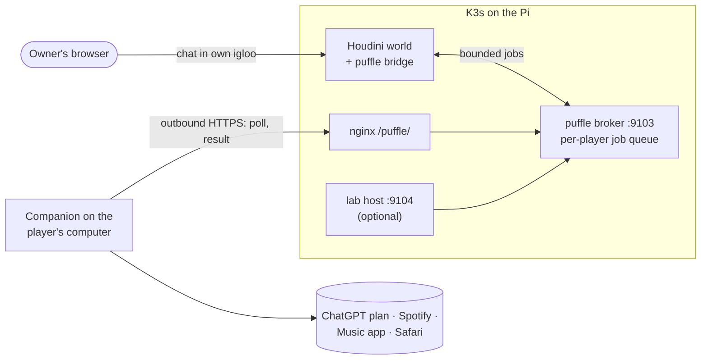

# Conversational puffle

In your own igloo you can write to your puffle in the game chat. It answers in a speech bubble
(48 characters at most) that everyone in the room sees, and it can control **your** music:
"pon Despacito", "pausa", "siguiente". Conversation uses the owner's own ChatGPT plan through
Sign in with ChatGPT. Music goes through the Spotify Web API, the macOS Music app, or Apple Music
in a dedicated Safari window.

The hard part is not the chat; it is trust. A multiplayer game server must never let a visitor,
a bot or a forged packet act on someone else's account or computer, and a slow provider must
never stall the world server. The design below exists to guarantee both.

## Components

| Piece | Where | Role |
|---|---|---|
| Bridge | `experiments/puffle_sim/bridge.py`, `production/puffle/world.py` | Patched into the world server; captures chat only after Houdini accepted it, checks that the speaker owns the igloo and a visible puffle, and sends the bubble back |
| Engine | `experiments/puffle_sim/engine.py` | Bounded in-memory conversation per visit; cut to safe, short speech |
| Broker | `production/puffle/broker.py` | Pairing, device leases and the per-player job queue; stores only pairing hashes in SQLite |
| Companion | `production/puffle/companion.py` | Runs on the player's computer; holds the OAuth tokens and talks to the providers; outbound HTTPS only |
| Device worker | `production/puffle/device_worker.py` | One job per short-lived process group, so cancelling it also kills any helper it launched |
| Lab host | `production/puffle/host.py` | Optional mode in which the server acts as the device for a short allowlist |
| Client | `experiments/puffle_sim/client/` | Renderer injected into `engine.swf` with FFDec, built reproducibly from pinned, checksummed inputs |

## Pairing and identity

Pairing binds a device to an authenticated game session in two independent steps:

1. The device asks the broker for a short-lived code.
2. The owner types `puffle conectar <code>` in their **own igloo**. The world server reports who
   typed it, so the identity comes from Houdini's authenticated session, never from an ID sent by
   a browser. Visitors never see the code.
3. The device shows the penguin's nickname and the owner confirms it there.

NPC accounts on a configurable deny list can never pair, an optional allowlist limits a pilot to
chosen player ids, and a device holds a lease that expires within seconds once it stops polling.
The owner can revoke a pairing from the game (`puffle desconectar`) or from the companion.

## Bounded work

The broker never lets puffle traffic compete with the game:

- One job per player at a time, at most 32 in total, a job expires after 25 seconds.
- At most 8 jobs per player per minute, with at least 2 seconds between them.
- Leaving the igloo, disconnecting, revoking or switching pets cancels pending work, and a late
  result is discarded.
- If the broker is down or disabled, the world keeps running and the puffle simply stays quiet.

## Music without trusting the model

Music commands never depend on the language model. A deterministic parser turns the owner's own
latest line into one of five intents (`play`, `pause`, `resume`, `next`, `previous`), and any
intent proposed elsewhere is accepted only if it matches what the parser read. Spotify metadata
is not fed back into the model. The puffle confirms "now playing" only after the backend reports
the selected track and artist, so a failed or ambiguous search never turns into a false claim.
Opening other applications on the Mac is off by default; when explicitly enabled, every action
comes from a fixed list and needs a native confirmation dialog.

## Credentials

- **Companion mode (default).** ChatGPT and Spotify tokens stay on the player's computer; the
  server never hosts third-party OAuth accounts. Sign in with ChatGPT uses PKCE, a loopback
  callback and ID-token validation; Spotify uses Authorization Code with PKCE and no client
  secret.
- **Lab host mode.** For a single operator and a short allowlist (at most five players), the
  server acts as the device. The browser only holds an HttpOnly session cookie and never sees the
  broker token or any Spotify token. Tokens are stored AES-256-GCM encrypted in SQLite, with
  associated data binding each row to its session or player, under a key mounted only into that
  service. OAuth `state` values are single-use and bound to the session that started the flow.

## Rollout controls

`puffle_enabled` in Terraform switches the feature. When it is off, the service and its device
volume stay in place but new jobs are refused; turning it on or off never changes images. A
release manifest records whether the release supports the puffle, so rolling back to an older
release automatically turns the feature off and scales the broker to zero, keeping its volume.
The web image avoids caching `engine.swf`, and the release records its hash, so browsers do not
keep a client that no longer matches the server.

## Testing

`tests/puffle_sim/` (112 tests) covers the engine, authority checks, the Houdini bridge on the
pinned upstream sources, the providers, Spotify, Music and Safari backends (with fake HTTP and
AppleScript), and the client protocol. `tests/production/` (27 tests) covers the broker, host,
device worker and HTTP transport. `scripts/test-containers.py --puffle` then runs the real
production entrypoint against a disposable Houdini, PostgreSQL and Redis with two paired
companions and a visitor, using synthetic answers on a network with no outbound access. No test
makes a real inference.
